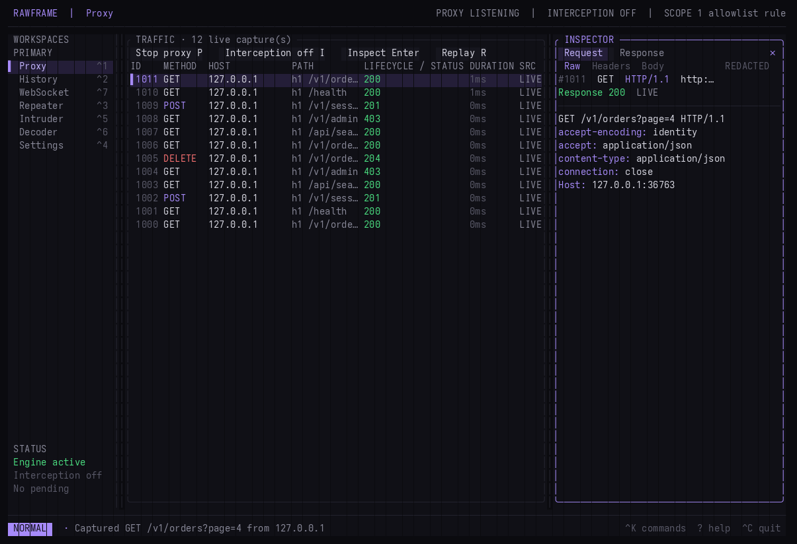
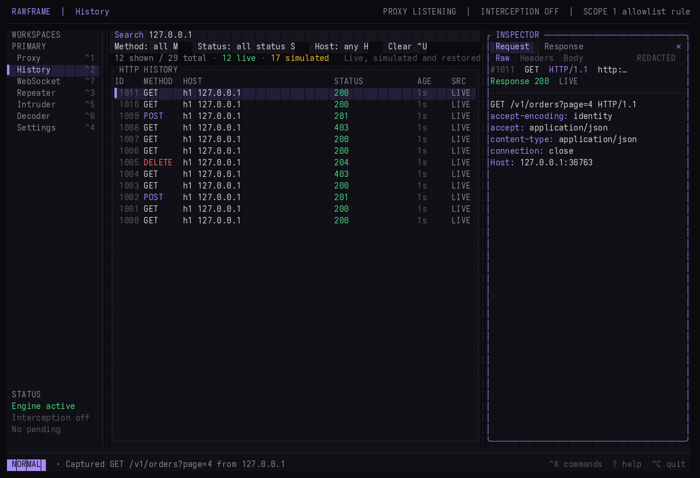
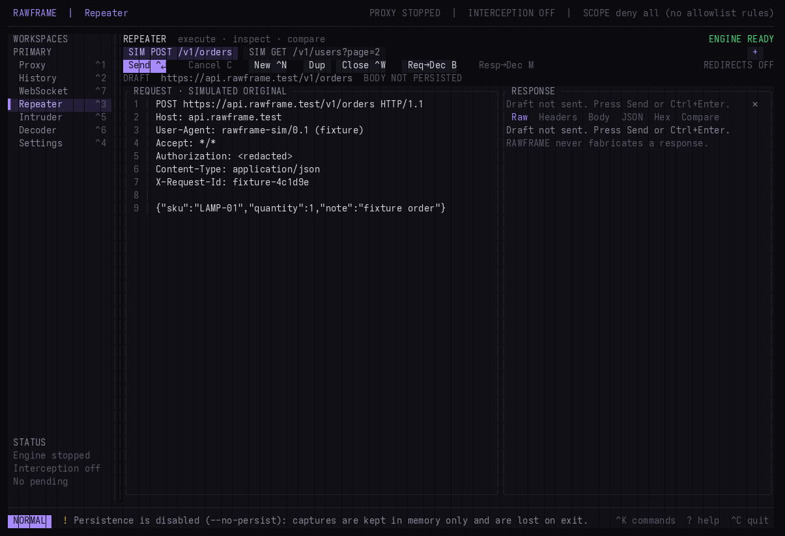
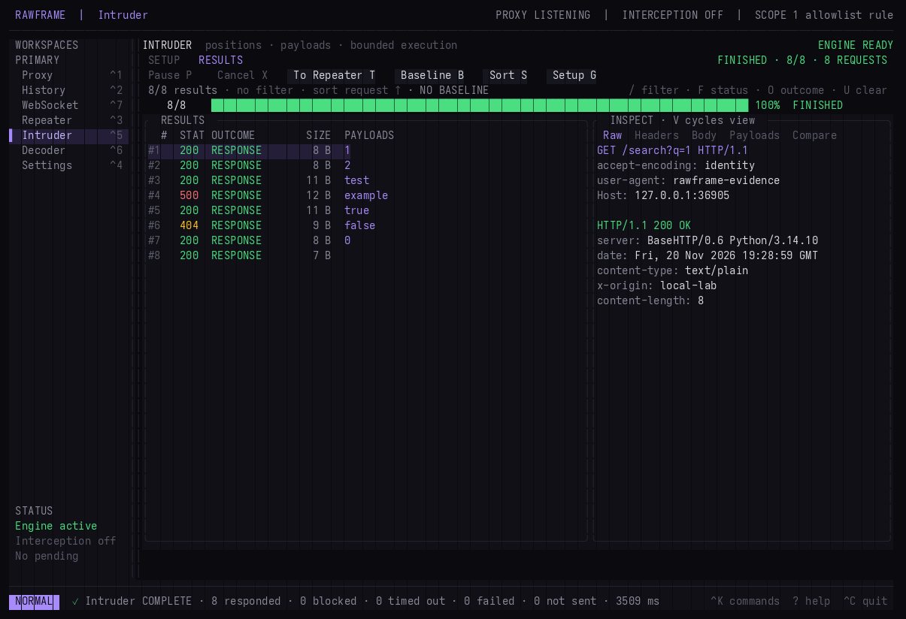
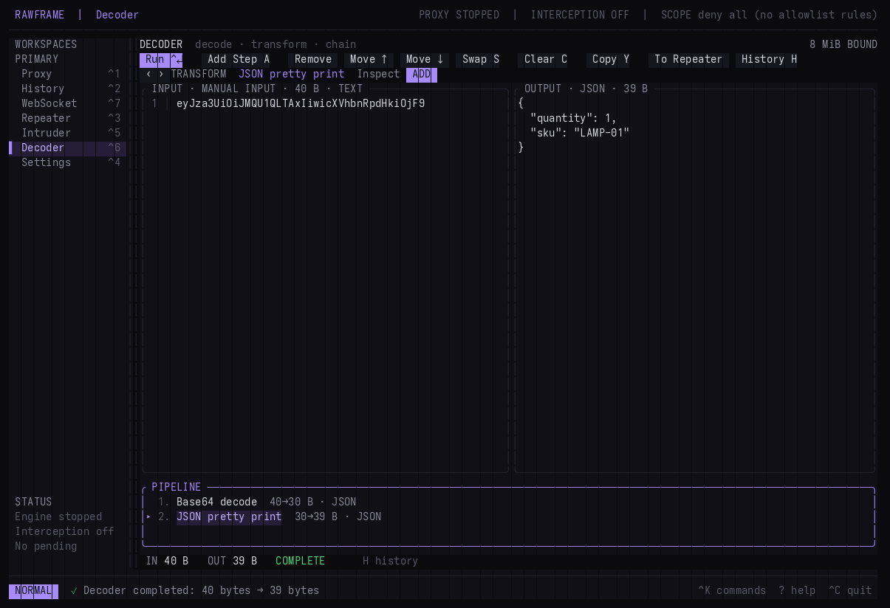
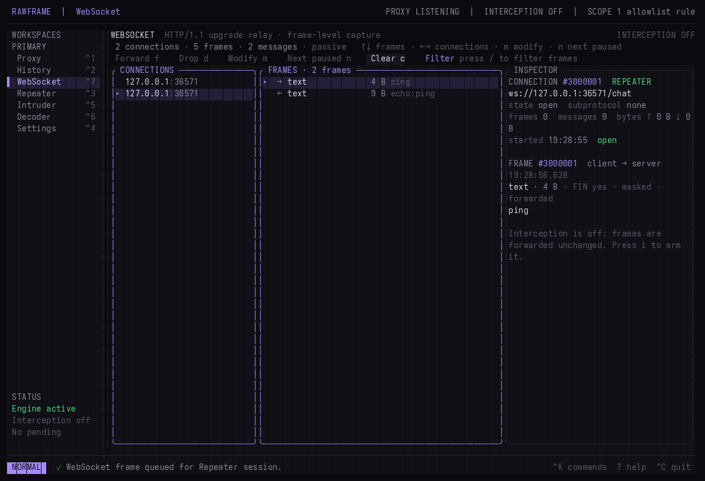
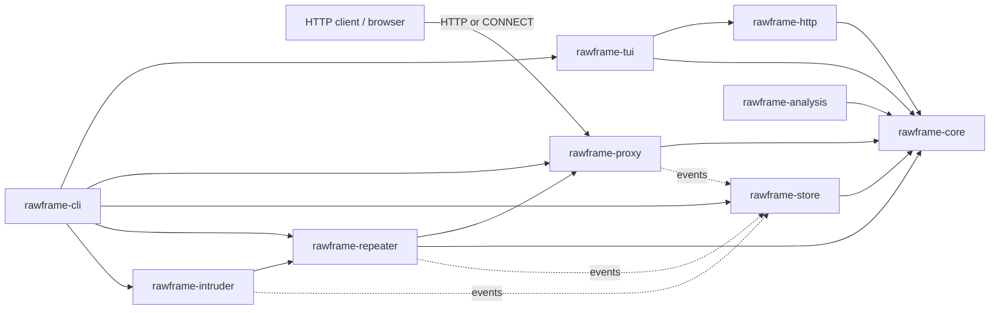

# RAWFRAME

**Terminal-native HTTP interception and security testing workbench.**

RAWFRAME is an open-source Rust workspace for authorized HTTP/1.1, HTTP/2, and
HTTP/1.1 WebSocket testing from the terminal. It provides a local forward proxy,
opaque HTTPS tunnelling, opt-in TLS interception, durable SQLite history, and a
live request workbench inside a keyboard-driven TUI.

RAWFRAME is intended **only** for systems you own or are explicitly authorized to
test.

**Current release: [1.0.0](CHANGELOG.md)** — the first stable release. Milestones
1–10 are complete and covered by the workspace test suite. See
[release status](#release-status) for exactly what is and is not in this build.



## Contents

- [Overview](#overview)
- [Feature highlights](#feature-highlights)
- [Screenshots](#screenshots)
- [Protocol support](#protocol-support)
- [Architecture](#architecture)
- [Security model](#security-model)
- [Limitations](#limitations)
- [Installation](#installation)
- [Build from source](#build-from-source)
- [Quick start](#quick-start)
- [TLS interception and trust](#tls-interception-and-trust)
- [Configuration and data storage](#configuration-and-data-storage)
- [Usage examples](#usage-examples)
- [Testing](#testing)
- [Troubleshooting](#troubleshooting)
- [Contributing](#contributing)
- [License](#license)
- [Release and changelog](#release-and-changelog)

## Overview

RAWFRAME is a local forward proxy plus a set of request workbenches that share
one domain model, one scope policy, and one storage layer. You point a client at
`127.0.0.1:8080`, explicitly allow the destinations you are testing, and every
request is either forwarded, paused for review, or refused — with the decision
recorded in a visible lifecycle state.

Design constraints that shape the whole application:

- **Explicit authority.** Scope is a default-deny allowlist. With no `--scope`
  rule, nothing is proxied.
- **Explicit decryption.** Opaque `CONNECT` tunnelling is the default. HTTPS is
  only decrypted after you enable TLS interception *and* trust the local CA in a
  client you control.
- **No silent downgrade.** Upstream certificate-chain and hostname verification
  cannot be disabled. There is no "ignore TLS errors" switch.
- **Bounded everything.** Bodies, connections, queues, frame sizes, payload
  lists, request counts, and timeouts all have hard ceilings.
- **Local only.** No telemetry, no external reporting, no automatic trust-store
  modification, and no shell execution from captured content.

## Feature highlights

**Proxy and destination policy**

- HTTP/1.1 forward proxying with streamed request and response bodies.
- HTTP/2 upstream and downstream over intercepted TLS when ALPN negotiates `h2`;
  HTTP/1.1 remains the fallback on either leg.
- Opaque HTTPS `CONNECT` tunnelling with bidirectional relay and half-close.
- IPv4, IPv6, and hostname destinations with absolute-form and `Host` validation.
- End-to-end header preservation, including duplicates and `Set-Cookie`, with
  hop-by-hop filtering.
- Default-deny scope by exact host, leading wildcard, scheme, and port.
- Resolve-once DNS with address validation for loopback, private, link-local,
  metadata, and reserved ranges.
- Body caps, connection limits, connect/response/idle timeouts, and bounded event
  and command queues.

**Request interception**

- Pause matching requests before any upstream contact.
- Inspect the raw request and forward it unchanged or modified after validation.
- Drop paused requests without fabricating an upstream response.
- Bounded pending queue, interception timeout, cancellation on disable or stop,
  and full lifecycle tracking.

**HTTPS TLS interception**

- Opt-in only, with a local certificate authority created on explicit request.
- Per-host leaf certificates with a bounded cache.
- Independent ALPN negotiation on the client and upstream legs.
- Separate upstream TLS session with mandatory chain and hostname verification.
- Decrypted requests enter the same interception queue, history, and lifecycle as
  plaintext HTTP.
- No certificate-pinning bypass: pinned clients fail the intercepted handshake by
  design.

**Durable history and sessions**

- SQLite persistence in a dedicated storage crate; the proxy and TUI never link
  SQLite.
- Versioned schema migrations, crash recovery, and `incomplete` markers for
  interrupted transactions.
- Captured traffic is written on a separate thread, so the request path never
  waits on disk.
- Sensitive header values are redacted before writing; bodies are stored only when
  explicitly opted in.
- Browse stored sessions, restore them read-only into History, and export redacted
  JSON Lines.
- Restored traffic is labelled `RESTORED`, is never live, and is never forwarded.

**Repeater**

- Real HTTP/1.1 and HTTP/2 execution to scoped destinations over direct client
  connections — no simulated responses.
- `http` and `https` schemes, arbitrary valid methods, custom ports, query
  strings, ordered duplicate headers, and binary request bodies.
- Multiple independent tabs with per-tab editor, draft state, execution history,
  redirect toggle, and response comparison.
- Raw, Headers, Body, Pretty JSON, Hex, and Compare views.
- Safe redirects are opt-in: at most five hops, every destination scope-checked,
  credentials stripped on cross-origin hops.
- Mandatory upstream verification, response limits, timeouts, cancellation, and
  bounded concurrency.

**Decoder**

- Binary-safe transformations: Base64 (standard and URL-safe), hex, URL percent,
  HTML entities, Unicode escapes, JWT inspection, JSON pretty/minify/validate,
  gzip compress/decompress, SHA-256/384/512, and MD5 as a clearly labelled legacy
  checksum.
- Chained pipeline with intermediate inspection, first-failure reporting, 8 MiB
  input/output and 16 steps.
- JWT inspection decodes header and payload and states that the signature is
  **not** verified.
- Explicit transfer of request or response bodies into and out of Repeater.

**Intruder**

- Payload positions marked with `§value§` in the URL path, query values, header
  values, and request body.
- Four strategies with exact request counts: Sniper, Battering Ram, Pitchfork,
  and Cluster Bomb.
- Payload sources: manual lists, built-in demo values, session-local named lists,
  and bounded local wordlist import.
- Real execution through the same scoped Repeater engine with a confirmation
  dialog, bounded concurrency, a local rate gate, pause/resume/cancel.
- Typed per-request outcomes and a results workspace with status, size, duration,
  payload inspection, filters, sort, and baseline comparison.
- No evasion features: no proxy rotation, throttling bypass, CAPTCHA or
  rate-limit circumvention, or distributed scanning.

**WebSocket interception and Repeater**

- HTTP/1.1 `Upgrade: websocket` handshakes are recognized, scope-checked, and
  relayed frame by frame instead of as an opaque byte stream.
- The proxy performs the upstream handshake over the verified TCP/TLS path and
  returns `101` only after upstream accepts.
- Per-frame interception in both directions: forward, drop, or modify text/binary
  payloads.
- Dedicated workspace listing connections and frame history with direction,
  opcode, length, outcome, and a payload inspector.
- Authored WebSocket Repeater sessions with verified TLS, text composition, and
  both directions shown.

**Security analysis engine (library)**

- `rawframe-analysis` ships a deterministic, versioned 17-rule inventory over
  captured HTTP/1.1, HTTP/2 shared messages, and WebSocket handshakes and text
  messages, with stable fingerprints, bounded scheduling, evidence redaction, and
  JSON/Markdown report formatting.
- The engine is a library: it is built, tested, and documented, but **not yet
  wired into the TUI or CLI**. There is no Security Findings workspace in 1.0.0.
  See [`docs/analysis-rules.md`](docs/analysis-rules.md).

**Terminal interface**

- Proxy, HTTP History, WebSocket, Repeater, Intruder, Decoder, and Settings
  workspaces.
- Request/response inspector with raw, headers, and body views.
- Keyboard navigation, mouse support, command palette, and resizable panes.
- Live engine state, TLS state, queue state, and source provenance.
- Sensitive-header redaction and terminal-safe rendering of captured text.

## Screenshots

Every image below is a real RAWFRAME render of the release binary inside a
140×40 PTY, rasterised from the ANSI cell grid by
`scripts/capture_readme_screenshots.py`. The application emits the colours; the
capture tool only paints the cells the terminal received. Font, dimensions,
SHA-256 hashes, and per-image colour counts are recorded in
[`docs/screenshots/readme/manifest.json`](docs/screenshots/readme/manifest.json).

| Proxy with live findings | HTTP History with the inspector open |
| --- | --- |
|  |  |

| Repeater | Intruder results |
| --- | --- |
|  |  |

| Decoder pipeline | WebSocket frames and Repeater |
| --- | --- |
|  |  |

Additional regression evidence is kept under `docs/screenshots/`:

- Live interception, modified forwarding, scope refusal, and TLS interception at
  140×40: `docs/screenshots/`.
- HTTPS interception lifecycle, including CA fingerprint and upstream
  verification failure: `docs/screenshots/tls/`.
- HTTP/2 at 140×40, 100×30, and 80×24: `docs/screenshots/http2/`.
- Repeater, Decoder, Intruder, and WebSocket at 140×40, 100×30, and 80×24:
  `docs/screenshots/repeater/`, `docs/screenshots/decoder/`,
  `docs/screenshots/intruder/`, and `docs/screenshots/websocket/`.

## Protocol support

| Capability | Supported | Notes |
| --- | --- | --- |
| HTTP/1.1 forwarding | Yes | Streamed bodies, hop-by-hop filtering, duplicate headers preserved. |
| Opaque HTTPS `CONNECT` | Yes | Default. Destination, bytes, and duration only. |
| HTTPS TLS interception | Opt-in | HTTP/1.1 and HTTP/2 after explicit CA trust. |
| HTTP/2 over TLS | Yes | Only when ALPN negotiates `h2`. |
| HTTP/2 cleartext (h2c) | No | Plaintext stays HTTP/1.1. |
| HTTP/1.1 WebSocket upgrade | Yes | Frame-level relay and interception. |
| WebSocket over HTTP/2 (RFC 8441) | No | — |
| HTTP/3, QUIC | No | — |
| WebSocket compression | No | Extensions are stripped; RSV bits rejected. |

## Architecture

RAWFRAME is a nine-crate Cargo workspace. Dependency flow is one-way: the TUI
never opens sockets or SQLite, and the proxy never depends on the TUI.

| Crate | Responsibility |
| --- | --- |
| `rawframe-core` | Domain models, configuration, scope rules, lifecycle, filters, bounded event/command contracts, terminal-safety primitives, and labelled fixtures. No network or terminal I/O. |
| `rawframe-http` | Authored HTTP/1.x document parser used by Repeater and tests. Not the live proxy wire implementation. |
| `rawframe-proxy` | Tokio/Hyper listener, HTTP forwarding, opaque `CONNECT` relay, TLS interception, HTTP/1.1 WebSocket handshake and frame relay, destination policy, body guards, limits, and graceful shutdown. |
| `rawframe-repeater` | Repeater execution engine: independent HTTP/1.1 and HTTP/2 connections over verified HTTPS, redirects, bounded response capture, timeouts, cancellation, and the command service; also the authored WebSocket client sessions. |
| `rawframe-intruder` | Intruder execution service: plan construction, payload expansion, bounded worker pool, rate gate, pause/resume/cancel, typed outcomes, and wordlist import. Executes through the Repeater engine. |
| `rawframe-analysis` | Passive analysis library: deterministic rules over captured HTTP and WebSocket snapshots, finding construction, fingerprinting, bounded scheduler, and report formatting. No network, terminal, or storage dependency. Not yet wired into the application. |
| `rawframe-store` | SQLite schema/migrations, a single writer thread, redaction-on-write, session queries, restore, and redacted export. No proxy or TUI dependency. |
| `rawframe-tui` | Ratatui/Crossterm application, workspaces, inspector, editor, layouts, input handling, and terminal lifecycle. |
| `rawframe-cli` | Composition root: CLI validation, logging, Tokio runtime, proxy worker, Repeater services, storage worker/capture pump, and TUI loop. |



### Request lifecycle

1. The client connects to the local proxy listener.
2. The proxy parses the destination and validates it against scope and address
   policy.
3. HTTP requests are forwarded upstream or paused by the interception queue.
4. HTTPS `CONNECT` is relayed as an opaque tunnel unless TLS interception is
   explicitly enabled.
5. Intercepted HTTPS traffic is terminated locally, decrypted, and handled
   through the existing HTTP interception lifecycle.
6. Upstream certificate-chain and hostname verification remains mandatory for
   intercepted sessions.

`rawframe-cli` owns the Tokio runtime and spawns `rawframe_proxy::run_service`,
the storage worker, and a capture pump subscribed to the same event bus. The TUI
exchanges commands and events through bounded channels, polls without blocking,
and renders captured traffic and lifecycle state. Storage failures are reported
in the UI; the proxy keeps running.

See [docs/architecture.md](docs/architecture.md) for the full data flow, module
map, and design decisions.

## Security model

TLS interception is security-sensitive. RAWFRAME keeps it explicit and bounded.
The full threat model is in [docs/security.md](docs/security.md).

- **Opt-in interception.** Opaque `CONNECT` is the default. TLS interception is
  off unless enabled with `--tls-intercept` or the Settings toggle.
- **Explicit CA trust.** RAWFRAME never installs its CA automatically. You must
  export the public certificate and trust it in a client or dedicated test
  profile you control.
- **Protected private key.** CA material lives under
  `$XDG_DATA_HOME/rawframe/ca` or `~/.local/share/rawframe/ca`. On Unix the key is
  `0600` and the directory `0700`. The private key is never exported, logged, or
  published in events or history.
- **No verification bypass.** Upstream certificate-chain and hostname
  verification cannot be disabled. `--tls-upstream-ca` replaces the trust roots
  for a lab; it does not weaken verification.
- **Scope before connection.** Scope is checked before DNS resolution or any
  upstream socket is opened. A denial is recorded as blocked and never forwarded.
- **Repeater is not a bypass.** Repeater opens its own scoped connections, uses
  the same resolve-once address policy, always verifies upstream TLS, and never
  enters the interception queue or trusts the local CA. Scope is re-checked
  before every redirect hop.
- **WebSocket is still scoped traffic.** The upgrade destination is scope-checked
  and address-validated before any upstream socket opens. Extensions are
  stripped, compression is not negotiated, RSV bits are rejected, and the client
  only receives `101` after upstream accepts.
- **Resolve-once address policy.** Every resolved address is validated before
  connection. Loopback and private upstreams require
  `--allow-private-upstreams`; link-local, metadata, multicast, documentation,
  and reserved ranges remain blocked.
- **Loopback by default.** Remote binding requires both a non-loopback `--bind`
  and `--allow-remote-bind`. There is no proxy authentication; protect any remote
  listener with host firewalls or a trusted network.
- **Redaction before storage.** Sensitive header values are replaced with
  `<redacted>` and bodies are stored as SQL `NULL` unless you opt in with
  `--persist-sensitive-headers` / `--persist-bodies`. Changing the policy never
  rewrites existing rows.
- **Protected database.** On Unix the database and exports are `0600` in a `0700`
  directory. WAL + `synchronous=FULL` limit crash loss, and a 512 MiB ceiling
  stops runaway growth with an explicit error instead of filling the disk.
- **Local data only.** No telemetry, external reporting, shell execution from
  captured content, or automatic trust-store modification. Diagnostics are
  written to a local log without captured headers or bodies.
- **Presentation safety.** Sensitive headers are redacted by default and captured
  text is sanitized before terminal rendering.
- **Bounded failure.** Bodies, connections, queues, and timeouts are bounded.
  Disabling interception or stopping the proxy cancels pending work instead of
  leaving it unresolved.

## Limitations

These are deliberate boundaries of the 1.0.0 release, not bugs.

- Plaintext proxying is HTTP/1.1 only; h2c is not implemented. HTTP/2 requires
  TLS and an `h2` ALPN result.
- WebSocket support is HTTP/1.1 upgrade only. RFC 8441 extended CONNECT,
  HTTP/2 WebSocket, HTTP/3, QUIC, compression, and subprotocol negotiation are
  not implemented.
- WebSocket interception is frame-level: fragmented messages are decided frame by
  frame, and a modified fragment keeps its original FIN/RSV state.
- TLS interception does not bypass certificate pinning. Pinned clients fail the
  intercepted handshake by design.
- Modified HTTPS requests cannot change the original `CONNECT` authority.
- Opaque tunnels expose only destination, duration, byte counts, and outcome.
- There is no configuration file. Settings, storage policy, body limits, and
  scope rules are runtime state: set them with CLI flags or in the UI for the
  current run.
- Bodies and sensitive header values are absent from stored history unless
  explicitly enabled, and cannot be recovered later.
- Repeater negotiates HTTP/2 automatically over verified TLS. There is no manual
  protocol override, h2c, client-certificate, or proxy-auth support.
- WebSocket Repeater sessions are separate authored connections, not replays of a
  captured socket. Text composition only.
- Intruder payload lists are session-only. Imported wordlists are read as local
  files, never executed, and capped at 4 MiB / 512 payloads per list. Payload
  values are stored as execution metadata, so a wordlist entry that is itself a
  credential would be stored unredacted.
- Intruder limits are 16 positions, 16 payload lists, 512 payloads per list,
  4096 bytes per payload, 2048 generated requests, 8 concurrent workers,
  20 requests/second, and a 1800 s duration ceiling.
- Decoder input and output are capped at 8 MiB, pipelines at 16 steps, and
  Decoder history is never persisted.
- Scope changes apply to new requests; established connections keep the rules
  they were admitted under.
- There is no proxy authentication, per-client rate limit, or `503` response for
  connection-limit overflow.
- Diagnostic logs are not rotated.
- The minimum usable TUI size is 64×18; the inspector requires 108 columns.
  Truecolor is assumed, and 8/16-colour terminals will degrade.
- `rawframe-analysis` is a tested library, but its rule engine has no user
  interface in 1.0.0.

## Installation

### Prebuilt release binary

Linux x86_64 builds are attached to each
[GitHub Release](https://github.com/dustin04x/RAWFR4ME/releases):

```bash
curl -LO https://github.com/dustin04x/RAWFR4ME/releases/download/v1.0.0/rawframe-v1.0.0-x86_64-unknown-linux-gnu.tar.gz
curl -LO https://github.com/dustin04x/RAWFR4ME/releases/download/v1.0.0/rawframe-v1.0.0-x86_64-unknown-linux-gnu.tar.gz.sha256

sha256sum --check rawframe-v1.0.0-x86_64-unknown-linux-gnu.tar.gz.sha256

tar -xzf rawframe-v1.0.0-x86_64-unknown-linux-gnu.tar.gz
install -m 755 rawframe ~/.local/bin/rawframe
rawframe --version   # rawframe 1.0.0
```

The release artifact is built from the tagged source with `--locked` and its
version output is checked against the tag before publication.

No other target is published for 1.0.0. macOS and Windows are not claimed to
work, and no builds are produced for them.

## Build from source

Prerequisites:

- Rust **1.89+** with edition 2024 support (`rustc --version`).
- A C toolchain for the bundled SQLite build (normally already present).
- A terminal of at least 64×18; 140×40 is recommended.
- A truecolor terminal and a monospace font with box-drawing coverage.
- Python 3 with Pillow only for regenerating screenshots.

```bash
git clone https://github.com/dustin04x/RAWFR4ME.git
cd RAWFR4ME

# Debug build
cargo build --workspace

# Optimised release binary
cargo build --workspace --release
./target/release/rawframe --version
```

Or install into `~/.cargo/bin`:

```bash
cargo install --path crates/rawframe-cli --locked
```

## Quick start

The proxy starts idle with default-deny scope. Press `P` on the Proxy workspace
to start it.

```bash
# Terminal 1: a local upstream to test against
python3 -m http.server 8000 --bind 127.0.0.1

# Terminal 2: RAWFRAME, authorizing only this local upstream
rawframe \
  --port 8080 \
  --scope http://127.0.0.1:8000 \
  --allow-private-upstreams
# Press P on the Proxy workspace, then request through the proxy.

# Terminal 3: send a request through the proxy
curl --noproxy '' -x http://127.0.0.1:8080 http://127.0.0.1:8000/
```

`--noproxy ''` matters: an inherited `NO_PROXY=127.0.0.1` would bypass the proxy
you are trying to test.

To pause a request instead of forwarding it, press `I` to enable interception,
send another request, then use `F` (forward), `E` (edit) and `Ctrl+Enter`
(send modified), or `D` (drop).

## TLS interception and trust

The CA is created when HTTPS TLS interception is first enabled, or explicitly
with `--tls-ca-regenerate`.

```bash
# Create a new local CA. This invalidates trust in any previous RAWFRAME CA.
rawframe --tls-ca-regenerate

# Inspect the public certificate path, status, and SHA-256 fingerprint.
rawframe --tls-ca-show
rawframe --tls-ca-fingerprint

# Export only the public certificate.
rawframe --tls-ca-export ./rawframe-ca.crt.pem

# Start with interception and an explicit HTTPS scope.
rawframe \
  --tls-intercept \
  --port 8080 \
  --scope https://lab.example.test:443
```

Trust model:

1. Use a disposable browser profile or a dedicated test VM.
2. Import `rawframe-ca.crt.pem` as a trusted authority **in that profile only**.
   Do not add it to the system trust store.
3. Configure the client to use `127.0.0.1:8080` as its HTTP/HTTPS proxy.
4. Confirm the target certificate is issued by the RAWFRAME CA before sending
   sensitive traffic.
5. When finished, disable interception, remove the CA from the profile, and
   delete the profile.

Only scoped `CONNECT` targets are eligible for interception. Removing trust does
not affect opaque tunnelling. `--tls-ca-regenerate` permanently invalidates the
old CA, and every client that trusted it must be updated.

For a local HTTPS origin, add `--allow-private-upstreams` and use the exact host
and port in `--scope`.

## Configuration and data storage

There is no configuration file. Everything is a CLI flag or a runtime toggle in
Settings.

| Setting | Default |
| --- | --- |
| Listener | `127.0.0.1:8080` |
| Scope | Empty allowlist; deny all |
| Request/response body cap | 2 MiB each |
| Concurrent client connections | 128 |
| Connect / response-header / idle timeout | 10 s / 30 s / 60 s |
| Interception timeout and queue | 120 s; 32 entries |
| HTTPS TLS interception | Off |
| Upstream TLS verification | On; cannot be disabled |
| Sensitive-header redaction | On |
| Persistence | On; local SQLite database |
| Stored bodies / sensitive headers | Off; SQL `NULL` and `<redacted>` |
| Database ceiling | 512 MiB |

Data locations (Unix):

| Item | Path |
| --- | --- |
| Database | `$XDG_DATA_HOME/rawframe/rawframe.db` (default `~/.local/share/rawframe/rawframe.db`) |
| CA material | `$XDG_DATA_HOME/rawframe/ca` |
| Log | `$XDG_DATA_HOME/rawframe/logs/rawframe.log` |

The data directory is `0700`; the database, CA key, and exports are `0600`.
Override with `--db <FILE>`, `--tls-ca-dir <DIR>`, and `--log-file <FILE>`.
Use `--no-persist` to keep history in memory only.

## Usage examples

**Persisted history**

```bash
# Default database
rawframe --scope http://127.0.0.1:8000 --allow-private-upstreams

# A named database and session
rawframe --db ./engagement.db --project acme --session-name baseline
```

Press `B` to browse stored sessions, `Enter` to restore one read-only into
History, and `E` to export it as redacted JSON Lines.

**Export without starting the UI**

```bash
rawframe --db ~/.local/share/rawframe/rawframe.db \
  --export-history ./engagement-history.jsonl

rawframe --db ~/.local/share/rawframe/rawframe.db \
  --export-session sess-abc123 \
  --export-history ./engagement-history.jsonl
```

Exports contain the stored, already-redacted rows, not live in-memory values.
Withheld bodies are marked `"omitted": true`; binary bodies are hex-encoded.

**Repeater**

Repeater does not require the proxy listener to be running.

1. Start with an explicit scope:
   `rawframe --scope http://127.0.0.1:8000 --allow-private-upstreams`
2. Press `Ctrl+3`, then `Enter`/`E` to edit the request line and headers. The
   request line uses an absolute URL, for example
   `POST http://127.0.0.1:8000/api HTTP/1.1`.
3. Press `Ctrl+Enter` or `S` to send; `C` cancels. `1`–`6` switch Raw, Headers,
   Body, Pretty JSON, Hex, and Compare. `F` toggles redirects.

**Intruder**

1. Capture or open a request, then press `I` to send it to Intruder.
2. In Setup press `M` to wrap a value in `§…§`, `Enter` to edit, `Space` to
   enable or disable a position, and `S` to choose a strategy.
3. Press `Ctrl+Enter` to review the confirmation — nothing is sent before you
   confirm — then `Y`. `P` pauses, `X` cancels, `V` cycles the inspector.

**CLI reference**

| Option | Purpose |
| --- | --- |
| `--bind <ADDR>` | Listener address. Defaults to `127.0.0.1`. |
| `--port <PORT>` | Listener port. Defaults to `8080`. |
| `--allow-remote-bind` | Required for a non-loopback bind address. |
| `--scope <RULE>` | Allow an upstream host; repeatable. No rules denies everything. |
| `--allow-private-upstreams` | Permit loopback/private targets for local labs. |
| `--no-mouse` | Disable mouse capture and interaction. |
| `--no-redact` | Show sensitive header values. Dangerous in shared environments. |
| `--log-file <FILE>` | Override the default diagnostic log path. |
| `--db <FILE>` | SQLite database for captured history. |
| `--no-persist` | Do not create or write a database; history is memory-only. |
| `--persist-bodies` | Store captured request/response bodies (off by default). |
| `--persist-sensitive-headers` | Store sensitive header values instead of `<redacted>`. |
| `--session-name <NAME>` | Name this capture session. |
| `--project <NAME>` | Name the project that owns this session. |
| `--export-history <FILE>` | Export stored history as JSON Lines and exit. |
| `--export-session <ID>` | Session to export; defaults to the newest session. |
| `--tls-intercept` | Enable HTTPS TLS interception for scoped `CONNECT` targets. |
| `--tls-ca-dir <DIR>` | Override the local CA directory. |
| `--tls-upstream-ca <FILE>` | Use an explicit PEM trust bundle; verification stays on. |
| `--tls-ca-show` | Print CA path/status and exit. |
| `--tls-ca-export <FILE>` | Export the public CA certificate and exit. |
| `--tls-ca-fingerprint` | Print the CA SHA-256 fingerprint and exit. |
| `--tls-ca-regenerate` | Replace the CA and exit. Invalidates prior trust. |

`--scope` accepts `host`, `host:port`, `http://host[:port]`,
`https://host[:port]`, and leading wildcards such as `*.example.test`.

**Keyboard shortcuts**

Single-letter shortcuts are suppressed while typing in an editor, search field,
or Settings field. `Ctrl+C` always exits.

| Shortcut | Action |
| --- | --- |
| `Ctrl+K` | Open the command palette. |
| `Ctrl+1` … `Ctrl+4` | Proxy, HTTP History, Repeater, and Settings. |
| `Ctrl+5` / `Ctrl+6` / `Ctrl+7` | Intruder / Decoder / WebSocket workspaces. |
| `Ctrl+F` | Search HTTP History. |
| `Ctrl+N` / `Ctrl+W` | Create / close a Repeater tab. |
| `Ctrl+U` | Clear HTTP History filters. |
| `B` | Browse stored sessions (restore read-only, export). |
| `Tab` / `Shift+Tab` | Move focus between navigation, content, and inspector. |
| `?` | Show keyboard help. |
| `Q` | Quit; confirmation is required with unsaved edits or paused requests. |
| `Ctrl+C` | Immediate emergency exit. |

Per-workspace shortcuts are listed in the `?` help overlay and in
[docs/development.md](docs/development.md).

## Testing

Run the repository quality gates from the workspace root:

```bash
cargo fmt --all --check
cargo check --workspace
cargo build --workspace
cargo test --workspace
cargo clippy --workspace --all-targets -- -D warnings
cargo build --workspace --release
```

Or run `./scripts/check.sh` for the short form.

The 1.0.0 release was verified with **499 passing tests, 0 failed, 0 ignored**
across the workspace. The suite covers proxy forwarding, streaming, duplicate
headers, malformed requests, scope and address policy, `CONNECT`, TLS
interception, HTTP/2, WebSocket relay and interception, Repeater execution and
redirects, Decoder pipelines, Intruder execution and cancellation, storage
migrations and crash recovery, export and redaction, and TUI rendering and input
at 140×40, 100×30, and 80×24.

Test suites use local servers and self-contained test CAs; no test contacts an
external website. Two environment notes:

- The TUI interception end-to-end test shells out to `curl`, so `curl` must be
  on `PATH`.
- `scripts/capture_readme_screenshots.py` regenerates the screenshot gallery and
  needs Pillow plus a monospace font with box-drawing coverage. Font discovery
  honours `RAWFRAME_MONO_FONT`, then fontconfig, then a fixed candidate list.

See [docs/development.md](docs/development.md) for the full test map.

## Troubleshooting

**`curl` returns "connection refused" or bypasses the proxy.**
An inherited `NO_PROXY`/`no_proxy` entry can bypass the proxy. Use
`curl --noproxy '' -x http://127.0.0.1:8080 ...`.

**Every request is blocked.**
Scope is default-deny. Add an explicit `--scope` rule for the exact host and
port. For loopback or private targets you also need `--allow-private-upstreams`.

**A browser shows a certificate error under interception.**
The RAWFRAME CA is not trusted in that profile, or interception was enabled after
the connection was established. Trust the exported public certificate in a
disposable profile and retry. Pinned clients cannot be intercepted by design.

**The UI looks plain or colours are wrong.**
RAWFRAME assumes a truecolor terminal. Set `COLORTERM=truecolor` or use a
terminal that supports 24-bit colour. Fonts without box-drawing coverage will
render panel borders incorrectly.

**The layout is cramped or refuses to render.**
The minimum usable size is 64×18, and the inspector needs 108 columns.

**The footer shows `DB ERROR`.**
The database is corrupt, locked, or the directory is not writable. Persistence is
disabled and the proxy keeps running. Use `--db <FILE>` to point at another path,
or `--no-persist` for a memory-only session. RAWFRAME never deletes the existing
file.

**`cargo clippy` fails on a newer toolchain.**
The gates are pinned to "warnings are errors". Run the exact command from
[Testing](#testing) and fix the reported lint rather than relaxing the gate.

**Editing Rust: build fails with edition 2024 or MSRV errors.**
Rust 1.89 or newer is required (`rustc --version`).

## Contributing

Contributions should preserve the security defaults: loopback binding,
default-deny scope, explicit private-upstream opt-in, mandatory upstream TLS
verification, redaction, and terminal sanitization. Add tests for behavioral
changes and run the quality gates before submitting.

- Read [CONTRIBUTING.md](CONTRIBUTING.md) for the workflow.
- Read [docs/development.md](docs/development.md) for the crate map and test
  commands.
- Report suspected vulnerabilities privately per [SECURITY.md](SECURITY.md).
  Do not open a public issue for them.

## Release status

| Milestone | Status |
| --- | --- |
| M1 — Core architecture and TUI | Complete |
| M2 — HTTP proxy engine | Complete |
| M3 — HTTP interception | Complete |
| M4 — HTTPS TLS interception | Complete |
| M5 — Persistence, sessions, and protocol coverage | Complete |
| M6 — Functional Repeater | Complete |
| M7 — Decoder and transformation workbench | Complete |
| M8 — Intruder payload workbench | Complete |
| M9 — HTTP/2 support | Complete |
| M10 — WebSocket interception and Repeater | Complete |
| M11 — Passive analysis | Engine library only; no Findings UI |
| Later — protocol expansion and release hardening | Planned |

Planned work is not available in this build. See [docs/roadmap.md](docs/roadmap.md)
for scope, acceptance criteria, and known limitations.

## License

MIT. See [LICENSE](LICENSE).

## Release and changelog

- Version: **1.0.0**
- Changelog: [CHANGELOG.md](CHANGELOG.md)
- Releases: <https://github.com/dustin04x/RAWFR4ME/releases>

## Documentation

- [Architecture](docs/architecture.md)
- [Security model](docs/security.md)
- [Development guide](docs/development.md)
- [Roadmap](docs/roadmap.md)
- [Analysis rule inventory](docs/analysis-rules.md)
- [Dependency graph](docs/dependency-graph.md)
- [Changelog](CHANGELOG.md)
- [Contributing](CONTRIBUTING.md)
- [Security policy](SECURITY.md)
