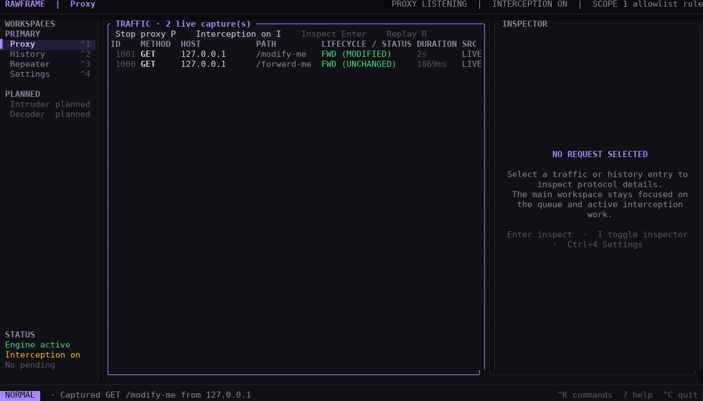
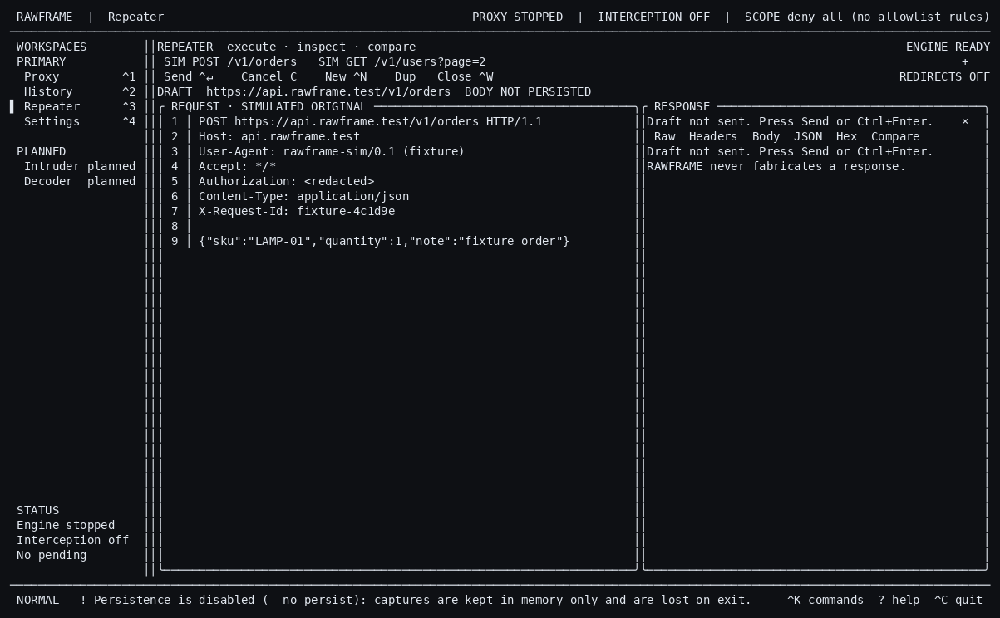
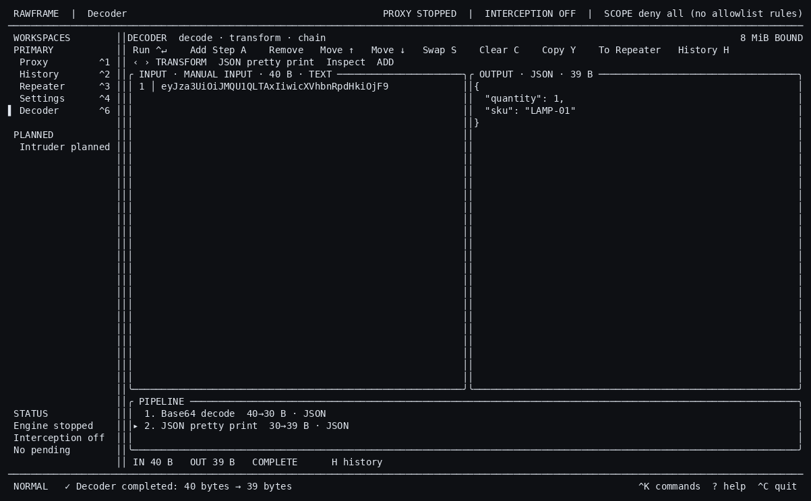
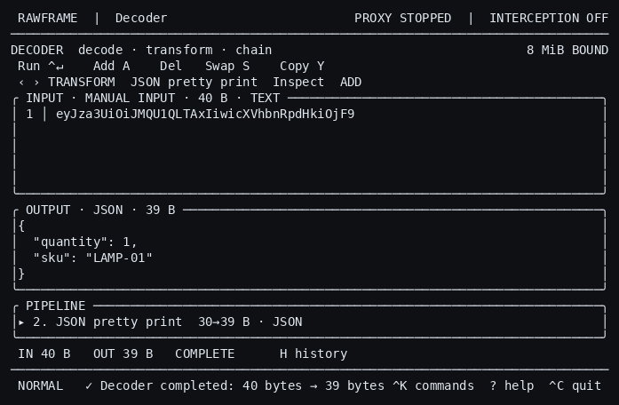
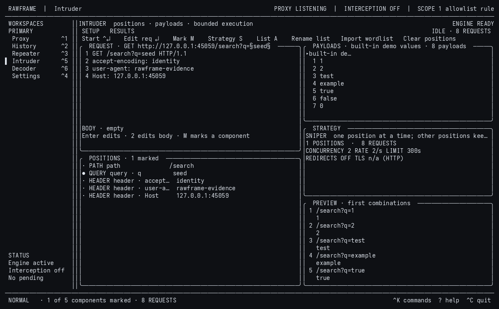
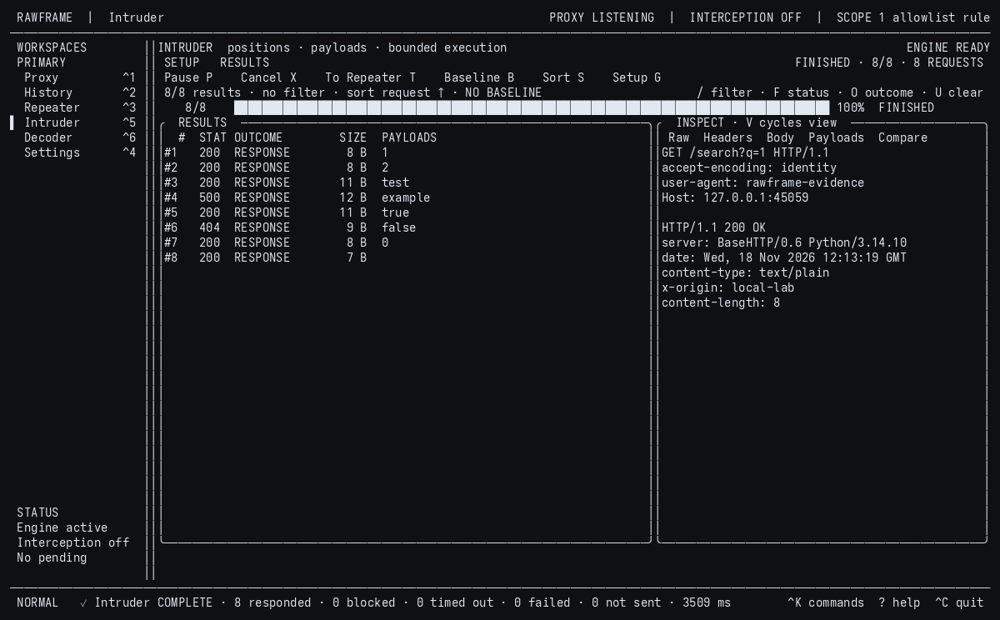
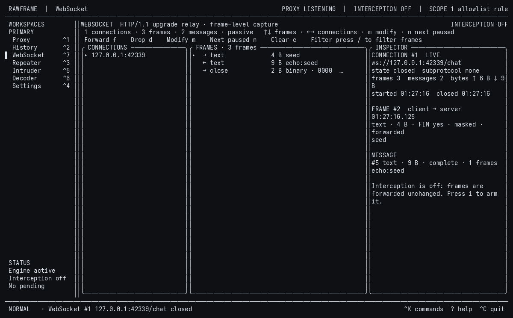
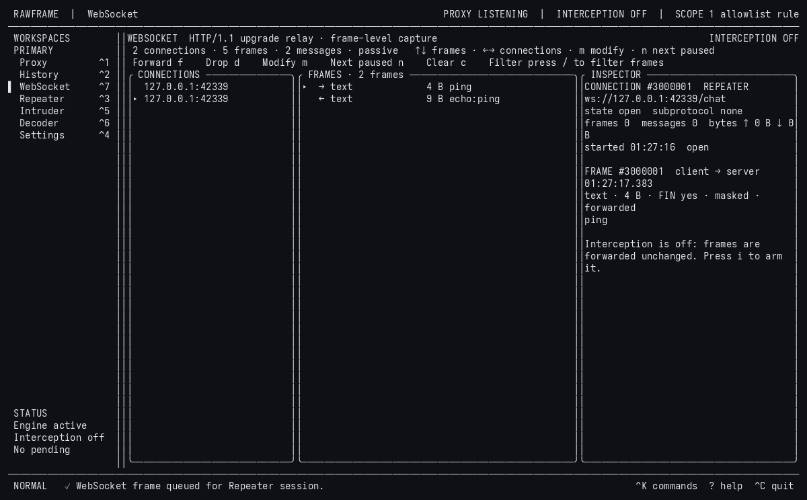
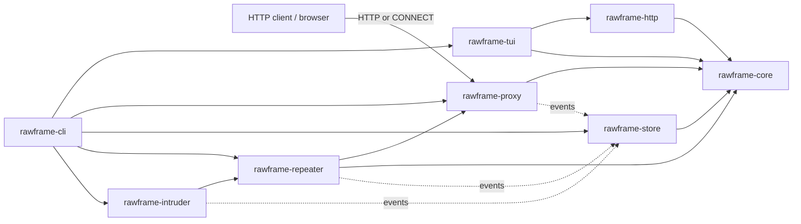

# RAWFRAME

**Terminal-native HTTP interception and security testing workbench.**

RAWFRAME is an open-source Rust workspace for authorized HTTP/1.1, HTTP/2, and HTTP/1.1 WebSocket testing from the terminal. It provides a local forward proxy, opaque HTTPS tunnelling, opt-in TLS interception, durable SQLite history with sessions and redacted export, and a live request workbench inside a keyboard-driven TUI. It is built for testers who want a compact terminal workflow with explicit scope and visible request lifecycle state.

The current release is **0.2.0**. Milestones 1–10 are complete: core application, HTTP proxy, HTTP interception, HTTPS TLS interception, durable history/sessions/export, a functional Repeater with real HTTP/HTTPS execution, a binary-safe Decoder with chained transformations and Repeater body transfer, an Intruder that runs real, bounded, scope-checked payload attacks with four strategies, genuine HTTP/2 over negotiated ALPN in the proxy, Repeater, and Intruder, and HTTP/1.1 WebSocket interception with frame-level relay, pause/forward/drop/modify, a dedicated workspace, persistence, and an authored WebSocket Repeater. Opaque `CONNECT` tunnelling is the default. HTTP/2 is used only when ALPN actually negotiates `h2`; plaintext HTTP stays HTTP/1.1 (no h2c). WebSocket support is HTTP/1.1 upgrade only: there is no HTTP/3, RFC 8441 extended CONNECT, WebSocket compression, or QUIC.

RAWFRAME is intended **only** for systems you own or are explicitly authorized to test.


## Screenshots

Captured from real PTY sessions of the current TUI at 140×40. These are terminal captures, not mockups.

| Live interception paused for review | Modified and unchanged requests forwarded |
| --- | --- |
|  |  |

| Decrypted HTTPS request | TLS settings and local CA fingerprint |
| --- | --- |
|  |  |

| Scope-blocked request with explanation | Repeater workspace with independent tabs |
| --- | --- |
|  |  |

| Decoder pipeline with intermediate results | Decoder at a narrow terminal |
| --- | --- |
|  |  |

| Intruder setup with a marked query payload position | Real Intruder results from a local origin |
| --- | --- |
|  |  |

| Captured WebSocket frames and inspector | Authored WebSocket Repeater session |
| --- | --- |
|  |  |

HTTP/2 evidence is captured from a real PTY at 140×40, 100×30, and 80×24
under `docs/screenshots/http2/` (`*_01_proxy_http2.txt`,
`*_02_inspector_http2.txt` where the inspector is visible, and
`*_03_history_http2.txt`). The capture script drives `curl --http2` through the
proxy against a local TLS origin that only offers `h2` and asserts
`%{http_version} = 2`; the text frames are the mandatory evidence.

The Repeater workspace is also captured from a real PTY at
[100×30](docs/screenshots/repeater/100x30_01_workspace.png) and
[80×24](docs/screenshots/repeater/80x24_01_workspace.png). The Decoder is
captured at [100×30](docs/screenshots/decoder/100x30_01_workspace.png) as well.
The Intruder is captured at [100×30](docs/screenshots/intruder/100x30_01_setup.png)
and [80×24](docs/screenshots/intruder/80x24_01_setup.png); each size also has the
confirmation, in-flight progress, and results frames (`*_02_confirm`,
`*_03_progress`, `*_04_results`) under `docs/screenshots/intruder/`.

WebSocket evidence is captured from a real PTY at 140×40, 100×30, and 80×24
under `docs/screenshots/websocket/`: captured frames (`*_01_frames.txt`), an
authored Repeater session (`*_02_repeater.txt`), and a composed text frame with
its echoed reply (`*_03_echo.txt`). `scripts/capture_websocket_pty.py` upgrades a
real client through the proxy to a local RFC 6455 echo server, opens the
Repeater, sends a text frame, and asserts the echo; the text frames are the
mandatory evidence.

## Features

### Implemented

**Proxy and destination policy**

- HTTP/1.1 forward proxying with streamed request and response bodies.
- HTTP/2 upstream and downstream over intercepted TLS when ALPN negotiates `h2`; HTTP/1.1 remains the fallback on either leg.
- Multiplexed HTTP/2 streams per intercepted connection, with per-stream interception decisions and bounded concurrency (128 streams, 64 KiB header lists).
- Opaque HTTPS `CONNECT` tunnelling with bidirectional relay and half-close.
- IPv4, IPv6, and hostname destinations with absolute-form and `Host` validation.
- End-to-end header preservation, including duplicates and `Set-Cookie`, with hop-by-hop filtering.
- Default-deny scope by exact host, leading wildcard, scheme, and port.
- Resolve-once DNS with address validation for loopback, private, link-local, metadata, and reserved ranges.
- Body caps, connection limits, connect/response/idle timeouts, and bounded event and command queues.

**WebSocket interception and Repeater**

- HTTP/1.1 `Upgrade: websocket` handshakes are recognized, scope-checked, and relayed frame by frame instead of as an opaque byte stream.
- The proxy performs the upstream handshake itself over the existing verified TCP/TLS path and only returns `101` to the client after upstream accepts, so a failed upgrade is never reported as success.
- Frames keep their boundaries and masking state in both directions; binary payloads, fragmentation, ping/pong, unknown control frames, and close frames are preserved.
- Interception is per frame in both directions: forward unchanged, drop, or modify text/binary payloads. A full interception queue forwards the frame unchanged and is surfaced as a warning; timeout or cancellation closes the WebSocket with `1001`.
- Completed text messages are validated as UTF-8; protocol errors close with the appropriate `1002`/`1007` status rather than forwarding corrupt data.
- A dedicated WebSocket workspace lists connections and frame history with direction, opcode, length, outcome, and a payload inspector; navigation, search/filter, mouse selection, and scrolling work at 140×40, 100×30, and 80×24.
- Connections and frames are persisted in schema v4, binary-safe and under the same body/redaction policy as HTTP history. Restored frames that had no stored payload are marked omitted rather than shown as empty.
- An authored WebSocket Repeater opens independent client sessions to scope-checked destinations with verified TLS, composes text frames, shows both directions, and never enters the proxy listener or interception queue.
- Bounds: 64 concurrent WebSocket tunnels, 2 MiB frame, 8 MiB message, 64 KiB retained payload per frame, 300 s idle timeout, and the existing bounded interception queue/timeout. Compression is not negotiated; RSV bits and extensions are rejected or stripped.

**HTTPS TLS interception**

- Opt-in TLS interception for HTTP/1.1 and HTTP/2; opaque `CONNECT` remains the default for clients that do not trust the local CA.
- Independent ALPN negotiation on the client and upstream legs; the negotiated protocol is recorded, never assumed.
- Local certificate authority with explicit creation, fingerprint display, and public-certificate export.
- Per-host leaf certificates with a bounded cache.
- Separate upstream TLS session with mandatory certificate-chain and hostname verification.
- Decrypted requests enter the same interception queue, history, and lifecycle as HTTP traffic.
- Enabling or disabling interception applies to new `CONNECT` sessions; established sessions keep their configuration until close.
- No certificate-pinning bypass.

**Durable history and sessions**

- SQLite persistence in a dedicated storage crate; the proxy and TUI never link SQLite.
- Versioned schema migrations, crash recovery, and `incomplete` markers for interrupted transactions.
- Captured traffic is written on a separate thread, so the proxy request path never waits on disk.
- Sensitive header values are redacted before writing; bodies are stored only when explicitly opted in.
- Browse stored sessions, restore them read-only into History, and export redacted JSON Lines.
- Restored traffic is labelled `RESTORED`, is never live, and is never forwarded.
- Live target-scope editing in Settings, applied to new requests without restarting the listener.

**Request interception**

- Pause matching requests before upstream contact.
- Inspect the raw request and forward it unchanged or modified after validation.
- Drop paused requests without fabricating an upstream response.
- Bounded pending queue, interception timeout, cancellation on disable/stop, and lifecycle tracking.

**Repeater**

- Real HTTP/1.1 and HTTP/2 execution to scoped destinations over direct client connections; no simulated responses or placeholder success states.
- Automatic HTTP/2 negotiation over TLS with an HTTP/1.1 fallback; the Repeater reports the protocol the server actually selected.
- `http` and `https` schemes, arbitrary valid methods, custom ports, query strings, ordered duplicate headers, and binary request bodies.
- Multiple independent tabs with per-tab editor, draft state, execution history, follow-redirect toggle, and response comparison.
- Separate editor and response panels (vertical split below 84 columns), Raw, Headers, Body, Pretty JSON, Hex, and Compare views.
- Explicit lifecycle phases: Draft, Validating, Connecting, Sending, Receiving, Completed, Failed, Cancelled, TimedOut, and Blocked by scope.
- Independent upstream connection per execution and per redirect hop; no CONNECT tunnel, local MITM CA, or interception queue is used.
- Mandatory upstream TLS certificate-chain and hostname verification; scope and private-address policy are enforced before every connection and redirect hop.
- Safe redirects are opt-in: at most five hops, every destination is scope-checked, and credentials are stripped on cross-origin hops.
- Response limits, timeouts, cancellation, and a bounded concurrency limit are enforced in the execution path.
- Completed transactions are attributed to Repeater provenance with the original capture reference, redacted through the same policy as proxy history, and distinguished from proxy traffic. Storage failures are reported without crashing execution.

**Decoder**

- Binary-safe transformations: Base64 (standard and URL-safe), hex, URL percent, HTML entities, Unicode escapes, JWT inspection, JSON pretty/minify/validate, gzip compress/decompress, SHA-256/384/512, and MD5 as a clearly labelled legacy checksum.
- JWT inspection decodes the header and payload, shows algorithm and claims, renders `exp`/`nbf`/`iat` times, and states that the signature is **not** verified.
- Chained pipeline: add, remove, and reorder steps; execute sequentially; inspect any intermediate result; stop at the first failure and report its exact step. Limits are 8 MiB input/output and 16 steps.
- Binary input and output stay as bytes. Non-text output is displayed as a bounded hex dump, invalid UTF-8 is never silently replaced, and gzip decompression is output-bounded.
- Session-only transformation history, copy through the terminal clipboard (OSC 52, best effort), swap, and clear.
- Explicit Repeater transfer: send the active request or response body to the Decoder, and insert the transformed output into a Repeater request body. Stored captures and the original request remain unchanged.

**Intruder**

- Payload positions marked with `§value§` in the URL path, query values, header values, and request body; multiple positions, each enabled, disabled, and individually identified, with binary-safe request bodies.
- Expansion preview and validation for malformed request heads, unmatched markers, markers inside header names, and non-UTF-8 values in URL or header positions. Per-position payload lists with explicit index assignments.
- Payload sources: editable manual lists, harmless built-in demo values, session-local named lists (create, rename, inspect, delete), and bounded local wordlists imported by path.
- Four strategies with exact request counts: Sniper, Battering Ram, Pitchfork, and Cluster Bomb. Counts, length mismatches, empty lists, and the request ceiling are reported before anything is sent.
- Real execution through the same scoped Repeater engine: bounded concurrency, a conservative default rate, per-request timeouts, bounded response capture, pause, resume, cancel, and shutdown.
- Typed per-request outcomes (response, blocked, timeout, failed, cancelled, not sent), progress, and a stop reason; redirects stay off unless enabled and are re-validated on every hop.
- Results workspace with real status, size, duration, payload values, search, status/outcome filters, sort, request/response inspection, payload inspection, baseline comparison, and explicit "send to Repeater".
- Explicit transfers: History, Repeater, and Decoder requests to the Intruder (the original capture is never mutated), and a chosen result back to Repeater without silent overwrite.
- No evasion features: no proxy rotation, throttling bypass, CAPTCHA or rate-limit circumvention, or distributed scanning. Status, size, and timing differences are reported as observations, never as vulnerability claims.

**Terminal interface**

- Proxy, HTTP History, WebSocket, Repeater, Intruder, Decoder, and Settings workspaces.
- Request/response inspector with raw, headers, and body views.
- Keyboard navigation, mouse support, command palette, and resizable panes.
- Live engine state, TLS state, queue state, and source provenance.
- Sensitive-header redaction and terminal-safe rendering of captured text.

### Planned, not implemented

- Advanced traffic analysis.
- HTTP/3, RFC 8441 extended CONNECT, WebSocket compression, and QUIC; plaintext h2c; HTTP/2 server push and priority controls.
- HTTP proxy authentication and per-client rate limits.

## Architecture

RAWFRAME is an eight-crate Cargo workspace. Dependency flow is one-way; the TUI never opens sockets or SQLite, and the proxy never depends on the TUI.

| Crate | Responsibility |
| --- | --- |
| `rawframe-core` | Domain models, configuration, scope rules, lifecycle, filters, bounded event/command contracts, terminal-safety primitives, and labelled fixtures. No network or terminal I/O. |
| `rawframe-http` | Authored HTTP/1.x document parser used by Repeater and tests. This is not the live proxy wire implementation. |
| `rawframe-proxy` | Tokio/Hyper listener, HTTP forwarding, opaque `CONNECT` relay, TLS interception, HTTP/1.1 WebSocket handshake and frame relay, destination policy, body guards, limits, and graceful shutdown. |
| `rawframe-repeater` | Repeater execution engine: request validation handoff, independent HTTP/1.1 and HTTP/2 connections over verified HTTPS, redirects, bounded response capture, timeouts, cancellation, and the command service; also the authored WebSocket client sessions used by the WebSocket Repeater. Reuses proxy destination/TLS policy but not its listener, CA, or interception queue. |
| `rawframe-intruder` | Intruder execution service: plan construction, payload expansion, bounded worker pool, rate gate, pause/resume/cancel, typed outcomes, and wordlist import. Executes through the Repeater engine instead of a second HTTP stack. |
| `rawframe-store` | SQLite schema/migrations, a single writer thread, redaction-on-write, session queries, restore, and redacted export. No proxy or TUI dependency. |
| `rawframe-tui` | Ratatui/Crossterm application, workspaces, inspector, editor, layouts, input handling, and terminal lifecycle. |
| `rawframe-cli` | Composition root: CLI validation, logging, Tokio runtime, proxy worker, HTTP Repeater service, WebSocket Repeater service, storage worker/capture pump, and TUI loop. |



### Request lifecycle

1. The client connects to the local proxy listener.
2. The proxy parses the destination and validates it against scope and address policy.
3. HTTP requests are forwarded upstream or paused by the interception queue.
4. HTTPS `CONNECT` is relayed as an opaque tunnel unless TLS interception is explicitly enabled.
5. Intercepted HTTPS traffic is terminated locally, decrypted, and handled through the existing HTTP interception lifecycle.
6. Upstream TLS certificate-chain and hostname verification remains mandatory for intercepted sessions.

`rawframe-cli` owns the Tokio runtime and spawns `rawframe_proxy::run_service`, plus the storage worker and a capture pump subscribed to the same event bus. The TUI exchanges commands and events through bounded channels, polls without blocking, and renders captured traffic and lifecycle state. Storage failures are reported in the UI; the proxy keeps running.

See [docs/architecture.md](docs/architecture.md) for the full data flow, module map, and design decisions.

## Security model

TLS interception is security-sensitive. RAWFRAME keeps it explicit and bounded.

- **Opt-in interception.** Opaque `CONNECT` is the default. TLS interception is off unless enabled with `--tls-intercept` or the Settings toggle.
- **Explicit CA trust.** RAWFRAME never installs its CA automatically. The operator must export the public certificate and trust it in the client or dedicated test profile.
- **Protected private key.** CA material is stored locally under `$XDG_DATA_HOME/rawframe/ca` or `~/.local/share/rawframe/ca`. On Unix, the key is `0600` and the directory is `0700`. The private key is never exported, logged, or published in events or history.
- **No verification bypass.** Upstream certificate-chain and hostname verification cannot be disabled. `--tls-upstream-ca` replaces the trust roots for a lab; it does not weaken verification.
- **Scope before connection.** Scope is checked before DNS resolution or any upstream socket is opened. A denial is recorded as blocked and never forwarded.
- **Repeater is not a bypass.** Repeater opens its own scoped connections, uses the same resolve-once address policy, always verifies upstream TLS, and never enters the interception queue or trusts the local CA. Scope is re-checked before every redirect hop.
- **WebSocket is still scoped traffic.** The upgrade destination is scope-checked and address-validated before any upstream socket opens. The upstream handshake is performed over verified TLS; extensions are stripped, compression is not negotiated, RSV bits are rejected, and the client only receives `101` after upstream accepts. Frame interception is bounded, and the authored WebSocket Repeater follows the same scope, address, and TLS rules as the HTTP Repeater.
- **Safe redirects.** Following redirects is off by default. When enabled, RAWFRAME caps the chain at five hops, validates each destination against scope, and removes `Authorization`, `Proxy-Authorization`, `Cookie`, `X-Api-Key`, `X-Auth-Token`, and `X-Csrf-Token` on cross-origin hops.
- **Resolve-once address policy.** Every resolved address is validated before connection. Loopback and private upstreams require `--allow-private-upstreams`; link-local, metadata, multicast, documentation, and reserved ranges remain blocked.
- **Loopback by default.** Remote binding requires both a non-loopback `--bind` and `--allow-remote-bind`. There is no proxy authentication; protect any remote listener with host firewalls or a trusted network.
- **Bounded failure.** Bodies, connections, queues, and timeouts are bounded. Disabling interception or stopping the proxy cancels pending work instead of leaving it unresolved.
- **Local data only.** No telemetry, external reporting, shell execution from captured content, or automatic trust-store modification. Diagnostics are written to a local log without captured headers or bodies.
- **Redaction before storage.** Sensitive header values are replaced with `<redacted>` and bodies are stored as SQL `NULL` unless the operator explicitly opts in with `--persist-sensitive-headers` / `--persist-bodies`. Changing the policy never rewrites existing rows.
- **Protected database.** On Unix the database and exports are `0600` in a `0700` directory; WAL + `synchronous=FULL` limit crash loss, and a 512 MiB ceiling stops runaway growth with an explicit error instead of filling the disk.
- **Honest save state.** The footer shows `DB ON`, `DB OFF`, or `DB ERROR`; dropped captures are counted and surfaced. Corrupt or unavailable databases disable persistence without deleting the file.
- **Presentation safety.** Sensitive headers are redacted by default, and captured text is sanitized before terminal rendering.
- **Intruder is confirmed and bounded.** Nothing is sent until the operator confirms a dialog that shows the target, strategy, request count, concurrency, rate, and scope. Every request is re-validated against scope and address policy, TLS verification stays mandatory, redirects are off by default and re-checked per hop, and there are no silent retries. Concurrency, rate, duration, payload size, position count, and the total request count are capped before execution, and stop/cancel aborts the pool instead of draining it.
- **No intrusion automation beyond request replay.** Intruder has no proxy rotation, evasion, CAPTCHA or rate-limit bypass, or distributed scanning. It does not classify responses as vulnerabilities; it reports observed status, size, timing, and body differences for the operator to interpret.
- **Decoder is local and inert.** Transformations run in-process on bounded byte buffers, never invoke a shell or external service, and are not persisted. JWT decoding never verifies a signature, and MD5 is labelled cryptographically broken. Repeater-to-Decoder transfer is explicit; it does not mutate stored captures.

### Limitations

- Plaintext proxying is HTTP/1.1 only; h2c is not implemented. HTTP/2 requires TLS and an `h2` ALPN result.
- WebSocket support is HTTP/1.1 upgrade only. RFC 8441 extended CONNECT, HTTP/2 WebSocket, HTTP/3, QUIC, compression (`permessage-deflate`), and subprotocol negotiation are not implemented. The upstream `Sec-WebSocket-Extensions` offer is stripped.
- WebSocket interception is frame-level but not message-assembly-aware beyond completed-text UTF-8 validation: fragmented messages are shown and decided frame by frame, and a modified fragment is sent with its original FIN/RSV state.
- HTTP/2 features beyond request/response framing (server push, priority, extended CONNECT) are not exposed. Header order is preserved where HTTP/2 permits it; pseudo-headers are represented as structured request fields rather than ordinary headers.
- TLS interception does not bypass certificate pinning. Pinned clients fail the intercepted handshake by design.
- Modified HTTPS requests cannot change the original `CONNECT` authority; changing host or port requires a new connection.
- Opaque tunnels expose only destination, duration, byte counts, and outcome; payload and inner headers are not captured.
- Captured history and sessions persist in SQLite. Settings, storage policy, and scope rules are runtime state: set them with CLI flags or in the UI for the current run. There is no configuration file.
- Bodies and sensitive header values are absent from stored history unless explicitly enabled, and cannot be recovered later.
- Repeater negotiates HTTP/2 automatically over verified TLS and falls back to HTTP/1.1. There is no manual protocol override, h2c, client-certificate, or proxy-auth support.
- WebSocket Repeater sessions are separate authored client connections, not replays of a captured socket. They seed only the destination, path, TLS choice, and subprotocol; captured cookies, headers, origin, and connection state are not copied. Text composition is supported; binary composition and per-frame editing in the Repeater are not.
- WebSocket connections are capped separately at 64, with a 2 MiB frame cap, 8 MiB message cap, 64 KiB retained payload, and 300 s idle timeout. The retained payload is truncated with an explicit flag; the relay itself still forwards the full frame while under the frame limit.
- WebSocket frame interception has no ordering barrier across connections: a paused frame holds only its own relay. Closing a paused connection or stopping the proxy cancels its pending frames.
- Repeater requests are re-validated against destination and scope on every execution, including edits and HTTP/2 requests; a connection is never reused across destinations.
- Repeater requests are direct; they do not traverse the local proxy listener or reuse a captured connection. A different client certificate, source address, or proxy path can produce a different result.
- Intruder executes through the Repeater engine, so it inherits HTTP/2 negotiation and HTTP/1.1 fallback. It has no h2c, WebSocket, or raw socket payloads, and no response-matching rules or fuzzing engine.
- Intruder payload lists are session-only and are never written to SQLite; only completed Intruder transactions are persisted, with the payload values that produced them. Those values are execution metadata, not sensitive headers, so they are stored and exported unredacted: a wordlist entry can itself be a credential. Imported wordlists are read as local files, never executed, and capped at 4 MiB / 512 payloads per list after UTF-8-safe validation.
- Intruder limits are 16 positions, 16 payload lists, 512 payloads per list, 4096 bytes per payload, 2048 generated requests, 8 concurrent workers, 20 requests/second, and a 1800 s duration ceiling. Rate is a local pacing control, not a guarantee about the target.
- Decoder input and output are capped at 8 MiB and pipelines at 16 steps. Large or highly compressible gzip streams are bounded by the output limit rather than fully expanded. Decoder history is session-only and is never written to SQLite. Copy uses terminal OSC 52 and may be ignored by terminals that disable clipboard access.
- Scope is edited in Settings or via `--scope`; wildcard and port rules apply to new proxy and Repeater requests immediately.
- There is no proxy authentication, per-client rate limit, or HTTP `503` response for connection-limit overflow.

See [docs/security.md](docs/security.md) for the threat model and the complete controls and gaps.

## Installation and usage

### Prerequisites

- Rust **1.89+** with edition 2024 support.
- A terminal of at least 64×18. The inspector requires 108 columns; 140×40 is recommended.
- A truecolor terminal and a monospace font with box-drawing coverage for the intended appearance.
- Python 3 with `cryptography` only for the real-binary PTY regression, not for normal operation.

### Build and run

```bash
git clone https://github.com/dustin04x/RAWFR4ME.git
cd RAWFR4ME
cargo build --workspace
cargo run -p rawframe-cli --bin rawframe
```

The proxy starts idle with default-deny scope. Press `P` on the Proxy workspace to start it.

### Quick local HTTP check

```bash
# Terminal 1: local upstream
python3 -m http.server 8000 --bind 127.0.0.1

# Terminal 2: RAWFRAME, authorizing only this local upstream
cargo run -p rawframe-cli --bin rawframe -- \
  --port 8080 \
  --scope http://127.0.0.1:8000 \
  --allow-private-upstreams
# Press P on the Proxy workspace.

# Terminal 3: send a request through the proxy
curl --noproxy '' -x http://127.0.0.1:8080 http://127.0.0.1:8000/
```

For a release build, use `cargo build --release -p rawframe-cli` and run `target/release/rawframe`.

### Persisted history

Captured traffic is written to a local SQLite database by default at `$XDG_DATA_HOME/rawframe/rawframe.db` or `~/.local/share/rawframe/rawframe.db`. The directory is `0700` and the database is `0600` on Unix.

- Sensitive header values are stored as `<redacted>`; bodies are stored as SQL `NULL`. Both are opt-in: `--persist-sensitive-headers` and `--persist-bodies` (also toggles in Settings).
- `--db FILE` chooses another database; `--no-persist` keeps everything in memory only.
- Changing the policy affects new captures only. It never rewrites existing rows.
- Press `B` to browse stored sessions, `Enter` to restore one read-only into History, and `E` to export it as redacted JSON Lines.
- The footer shows `DB ON (n stored)`, `DB OFF`, or `DB ERROR`. Corrupt or unavailable databases disable persistence with an explicit message; the proxy keeps running.

Export without starting the UI (newest session, or a specific one):

```bash
rawframe --db ~/.local/share/rawframe/rawframe.db \
  --export-history ./engagement-history.jsonl

rawframe --db ~/.local/share/rawframe/rawframe.db \
  --export-session sess-abc123 \
  --export-history ./engagement-history.jsonl
```

Exports contain the stored, already-redacted rows, not live in-memory values. Withheld bodies are marked `"omitted": true`; binary bodies are hex-encoded.

### Enable HTTPS interception

The CA is created when HTTPS TLS interception is first enabled, or explicitly with `--tls-ca-regenerate`. For a new test setup:

```bash
# Create a new local CA. This invalidates trust in any previous RAWFRAME CA.
target/debug/rawframe --tls-ca-regenerate

# Inspect the public certificate path, status, and SHA-256 fingerprint.
target/debug/rawframe --tls-ca-show
target/debug/rawframe --tls-ca-fingerprint

# Export only the public certificate.
target/debug/rawframe --tls-ca-export ./rawframe-ca.crt.pem

# Start with interception and an explicit HTTPS scope.
target/debug/rawframe \
  --tls-intercept \
  --port 8080 \
  --scope https://lab.example.test:443
```

For a local HTTPS origin, add `--allow-private-upstreams` and use the exact host and port in `--scope`.

Then:

1. Use a disposable browser profile or dedicated test VM.
2. Import `rawframe-ca.crt.pem` as a trusted certificate authority in that profile only. Do not add it to the system trust store.
3. Configure the client to use `127.0.0.1:8080` as its HTTP/HTTPS proxy.
4. Confirm that the target certificate is issued by the RAWFRAME CA before sending sensitive traffic.
5. Disable TLS interception or restart without `--tls-intercept`, remove the CA from the profile, and delete the profile when finished.

Only scoped `CONNECT` targets are eligible for interception. Removing trust does not affect opaque tunnelling. `--tls-ca-regenerate` permanently invalidates the old CA; every client that trusted it must be updated.

### Repeater quick start

Repeater is independent of the proxy listener and does not require pressing `P`.

1. Start with an explicit scope and, for a local lab origin, private-upstream permission:

   ```bash
   target/debug/rawframe --scope http://127.0.0.1:8000 --allow-private-upstreams
   ```

2. Press `Ctrl+3` for Repeater, then `Enter`/`E` to edit the seeded request line and headers. The request line uses an absolute URL, for example `POST http://127.0.0.1:8000/api HTTP/1.1`.
3. Press `Ctrl+Enter` or `S` to send; `C` cancels an execution. Responses render on the right (or below in an 80-column terminal).
4. Use `1`–`6` for Raw, Headers, Body, Pretty JSON, Hex, and Compare. `F` toggles safe redirect following; `X` clears the current response.
5. Close a tab with `Ctrl+W`; `Ctrl+N` creates a new blank tab. Each tab keeps its own document, in-flight execution, response, and execution history.

### Intruder quick start

Intruder reuses Repeater's execution path, so the same scope and TLS rules apply.

1. Start with an explicit scope for the target, for example `--scope http://127.0.0.1:8000 --allow-private-upstreams`.
2. Capture or open a request in HTTP History, then press `I` (or `Ctrl+5` for an empty workspace before loading). `I` in Repeater sends the active document; `I` on the Decoder sends its output to a payload list.
3. In Setup, move over the request components and press `M` to wrap a value in `§…§`. `Enter` edits the request head or body, and `Space` enables or disables a marked position.
4. Manage payload lists with `A` (create), `L` (rename), `N`/`B` (cycle), `X` (delete), and `W` (import a wordlist); press `Enter` on the payload panel to type values. Choose a strategy with `S`. The header shows the exact request count, and the preview shows the first expanded requests.
5. Press `Ctrl+Enter` to review the confirmation, then confirm with `↵`/`Y`. Results stream in as they complete; `P` pauses and resumes, `X` cancels.
6. In Results, `↑`/`↓` selects a row, `V` cycles Raw, Headers, Body, Payloads, and Compare, `/` searches payload values, `F`/`O` filter by status and outcome, `S` sorts, `B` picks a baseline, and `T` sends the selected result to Repeater.

Intruder runs write real results into History with `INTRUDER` provenance, the payload values used, and the originating capture when there was one. Payload lists themselves are session-only.

Completed Repeater executions appear in HTTP History with `REPEATER` provenance and the original capture reference when the document came from History or the proxy. They are persisted under the same redaction/body policy as proxy traffic. No proxy capture is fabricated.

### CLI reference

```text
rawframe [OPTIONS]
```

| Option | Purpose |
| --- | --- |
| `--bind <ADDR>` | Listener address. Defaults to `127.0.0.1`. |
| `--port <PORT>` | Listener port. Defaults to `8080`. |
| `--allow-remote-bind` | Required for a non-loopback bind address. |
| `--scope <RULE>` | Allow an upstream host; repeatable. Supplying no rules denies everything. |
| `--allow-private-upstreams` | Permit loopback/private targets for local labs. |
| `--no-mouse` | Disable mouse capture and interaction. |
| `--no-redact` | Show sensitive header values. Dangerous in shared environments. |
| `--log-file <FILE>` | Override the default local diagnostic log path. |
| `--db <FILE>` | SQLite database for captured history. |
| `--no-persist` | Do not create or write a database; history is memory-only. |
| `--persist-bodies` | Store captured request/response bodies (off by default). |
| `--persist-sensitive-headers` | Store sensitive header values instead of `<redacted>` (off by default). |
| `--session-name <NAME>` | Name this capture session. |
| `--project <NAME>` | Name the project that owns this session. |
| `--export-history <FILE>` | Export stored history as JSON Lines and exit. |
| `--export-session <ID>` | Session to export; defaults to the newest session. |
| `--tls-intercept` | Enable HTTPS TLS interception for scoped `CONNECT` targets. |
| `--tls-ca-dir <DIR>` | Override the local CA directory. |
| `--tls-upstream-ca <FILE>` | Use an explicit PEM trust bundle for upstream TLS; verification stays on. |
| `--tls-ca-show` | Print CA path/status and exit. |
| `--tls-ca-export <FILE>` | Export the public CA certificate and exit. |
| `--tls-ca-fingerprint` | Print the CA SHA-256 fingerprint and exit. |
| `--tls-ca-regenerate` | Replace the CA and exit. Invalidates prior trust. |

`--scope` accepts `host`, `host:port`, `http://host[:port]`, `https://host[:port]`, and leading wildcards such as `*.example.test`. HTTPS scope rules are required for intercepted `CONNECT` targets and for Repeater HTTPS requests.

## Keyboard shortcuts

Single-letter shortcuts are suppressed while typing in an editor, search field, or Settings field. `Ctrl+C` always exits.

### Global

| Shortcut | Action |
| --- | --- |
| `Ctrl+K` | Open the command palette. |
| `Ctrl+1` … `Ctrl+4` | Go to Proxy, HTTP History, Repeater, and Settings. |
| `Ctrl+5` | Open the Intruder workspace. |
| `Ctrl+6` | Open the Decoder workspace. |
| `Ctrl+7` | Open the WebSocket workspace. |
| `Ctrl+F` | Search HTTP History. |
| `Ctrl+N` | Create a Repeater tab. |
| `Ctrl+W` | Close the current Repeater tab. |
| `Ctrl+U` | Clear HTTP History filters. |
| `B` | Browse stored sessions (restore read-only, export). |
| `Tab` / `Shift+Tab` | Move focus between navigation, content, and inspector. |
| `?` | Show keyboard help. |
| `Q` | Quit; confirmation is required with unsaved edits or paused requests. |
| `Ctrl+C` | Immediate emergency exit. |

### Proxy

| Shortcut | Action |
| --- | --- |
| `↑` / `↓`, `J` / `K` | Move through traffic or the pending queue. |
| `PageUp` / `PageDown` | Move by eight rows. |
| `Home` / `End` | Jump to the first or last row. |
| `Enter` | Inspect the selected request. |
| `P` | Start or stop the proxy. |
| `I` | Toggle interception. |
| `F` | Forward a paused request unchanged. |
| `E` | Edit a paused request in the workbench. |
| `S` | Send the modified request after validation. |
| `Ctrl+Enter` | Send the modified request while the editor is active. |
| `D` | Drop the paused request. |
| `R` | Open the selected request in Repeater. |

### HTTP History and inspector

| Shortcut | Action |
| --- | --- |
| `/` or `Ctrl+F` | Search History. |
| `M`, `S`, `H` | Cycle method, status, and host filters. |
| `Enter` | Open the selected request in the inspector. |
| `[` / `]`, `←` / `→` | Switch the inspector between request and response. |
| `1`, `2`, `3` | Show raw, headers, or body view. |
| `X` | Toggle sensitive-header redaction in the inspector. |
| `R` / `E` | Open the selected request in Repeater, view or edit mode. |

### WebSocket

| Shortcut | Action |
| --- | --- |
| `↑` / `↓` | Move through frames for the selected connection. |
| `←` / `→` | Switch connections. |
| `Home` / `End`, `PageUp` / `PageDown` | Jump to the first/last frame or move by a page. |
| `Enter` | Inspect the selected frame. |
| `I` | Toggle WebSocket frame interception. |
| `F` / `D` | Forward or drop the selected paused frame. |
| `M` | Edit the selected paused frame's payload; `Ctrl+Enter` sends it. |
| `N` | Jump to the next paused frame. |
| `/` | Filter frames by text, opcode, or direction. |
| `C` | Clear the local frame view (the connection and relay are unaffected). |
| `O` | Open a WebSocket Repeater session seeded from the selected connection. |
| `T` | Compose a text frame for the active Repeater session. |
| `S` | Close the active WebSocket Repeater session. |
| Mouse | Click to select connections and frames; the wheel scrolls the focused pane. |

### Repeater and Settings

| Context | Shortcut | Action |
| --- | --- | --- |
| Repeater | `Enter` / `E` | Start editing the active document. |
| Repeater | `S` or `Ctrl+Enter` | Validate and execute the active document. |
| Repeater | `C` | Cancel the in-flight execution for the active tab. |
| Repeater | `←` / `→` | Switch tabs. |
| Repeater | `F` | Toggle safe redirect following for the active tab. |
| Repeater | `1`–`6` | Raw, Headers, Body, Pretty JSON, Hex, Compare. |
| Repeater | `X` | Clear the current response (history is retained). |
| Repeater | `B` / `M` | Send the current request body / response body to the Decoder. |
| Repeater | `I` | Send the active document to the Intruder. |
| History | `I` | Send the selected request to the Intruder. |
| Decoder | `I` | Send the current output to a new Intruder payload list. |
| Intruder | `Ctrl+Enter` | Review and confirm the plan (nothing is sent before confirmation). |
| Intruder | `M` | Mark or unmark the selected request component as a payload position. |
| Intruder | `Space` | Enable or disable the selected position. |
| Intruder | `S` | Cycle strategy in Setup; cycle sort order in Results. |
| Intruder | `A` / `L` | Create a named payload list / rename the active list. |
| Intruder | `X` | Delete the active list in Setup; cancel the run in Results. |
| Intruder | `C` / `D` / `+` / `-` | Cycle concurrency / duration limit / requests per second. |
| Intruder | `R` | Toggle redirect following (re-validated per hop). |
| Intruder | `P` / `X` | Pause or resume / cancel the running attack. |
| Intruder | `G` | Switch between Setup and Results. |
| Intruder | `N` / `B` | Next payload list (Setup) or choose a baseline (Results). |
| Intruder | `E` / `2` | Edit the request head / the request body. |
| Intruder | `Z` | Clear all payload positions. |
| Intruder | `↑` / `↓` | Select a position (Setup) or a result (Results). |
| Intruder | `V` | Cycle the result inspector: Raw, Headers, Body, Payloads, Compare. |
| Intruder | `F` / `O` / `U` | Cycle status filter, outcome filter, or clear result filters. |
| Intruder | `T` / `Y` | Send the selected result to Repeater / to the Decoder. |
| Intruder | `/` | Search results by payload value. |
| Intruder | `W` | Import a local wordlist by path. |
| Decoder | `1` / `2` / `3` | Focus the input, pipeline, or output panel. |
| Decoder | `Enter` / `E` | Edit the input; with the pipeline focused, preview the selected step. |
| Decoder | `←` / `→` or `[` / `]` | Select the transformation. |
| Decoder | `D` | Toggle the selected transformation's encode/decode direction. |
| Decoder | `A` / `Delete` | Add the selected transformation / remove the selected step. |
| Decoder | `Ctrl+↑` / `Ctrl+↓` | Move the selected step up or down. |
| Decoder | `Ctrl+Enter` or `R` | Execute the pipeline. |
| Decoder | `V` / `0` | Preview the selected intermediate step / return to final output. |
| Decoder | `S` / `C` / `Y` | Swap input and output / clear input and output / copy output. |
| Decoder | `H` | Open or close transformation history. |
| Settings | `↑` / `↓`, `J` / `K` | Select a setting. |
| Settings | `Enter` / `Space` | Toggle or edit the selected setting; **Target scope** opens the live rule editor. |
| Settings | `Esc` | Cancel an inline edit. |
| Scope editor | `Enter` / `Del` / `Ctrl+B` | Add typed rule / remove selected / toggle default-deny. |
| Stored sessions | `↑` / `↓`, `Enter`, `E`, `R` | Select, restore read-only, export, refresh. |

Mouse support includes click-to-select, double-click inspection, right-click context menus, wheel scrolling, and draggable pane dividers. Disable it with `--no-mouse`.

Captured history and sessions persist in SQLite. Settings, body limits, storage policy, and scope rules are not saved to a configuration file: choose them with CLI flags or in the UI for this run. Network limit changes apply after the proxy is restarted; scope edits apply to new requests immediately.

## Defaults

| Setting | Default |
| --- | --- |
| Listener | `127.0.0.1:8080` |
| Scope | Empty allowlist; deny all |
| Request/response body cap | 2 MiB each |
| Concurrent client connections | 128 |
| Connect / response-header / idle timeout | 10 s / 30 s / 60 s |
| Interception timeout and queue | 120 s; 32 entries |
| HTTPS TLS interception | Off |
| Upstream TLS verification | On; cannot be disabled |
| Sensitive-header redaction | On |
| Persistence | On; local SQLite database |
| Stored bodies / sensitive headers | Off; SQL `NULL` and `<redacted>` |
| Database ceiling | 512 MiB |

Diagnostics default to `$XDG_DATA_HOME/rawframe/logs/rawframe.log` or `~/.local/share/rawframe/logs/rawframe.log`. Logs contain lifecycle data, not captured headers or bodies. The file is owner-only on Unix.

## Roadmap

Milestone numbers follow [docs/roadmap.md](docs/roadmap.md).

| Milestone | Status |
| --- | --- |
| M1 — Core architecture and TUI | Complete |
| M2 — HTTP proxy engine | Complete |
| M3 — HTTP interception | Complete |
| M4 — HTTPS TLS interception | Complete |
| M5 — Persistence, sessions, and protocol coverage | Complete |
| M6 — Functional Repeater | Complete |
| M7 — Decoder and transformation workbench | Complete |
| M8 — Intruder payload workbench | Complete |
| M9 — HTTP/2 support | Complete |
| M10 — WebSocket interception and Repeater | Complete |
| Later — traffic analysis, protocol expansion, release hardening | Planned |

Planned work is not available in this build. See [docs/roadmap.md](docs/roadmap.md) for scope, acceptance criteria, and known limitations.

## Testing

Run the repository quality gates from the workspace root:

```bash
cargo fmt --all --check
cargo clippy --workspace --all-targets -- -D warnings
cargo test --workspace
```

Or run `./scripts/check.sh`.

The latest verified M10 run reported:

- **475 passing tests, 0 failed** across the workspace (M9 baseline: 447), including real local HTTP/HTTPS Repeater executions, binary bodies, duplicate headers, redirect loops and credential stripping, scope refusal, timeouts, cancellation, response limits, Repeater persistence/redaction, an end-to-end M5 schema-v1 upgrade fixture, a complete Decoder transformation/pipeline matrix with known hash vectors, malformed input, and size limits, Intruder planning/strategy counts, wordlist import, bounded execution against local HTTP and HTTPS servers, pause/resume/cancel, persistence, transfers, and TUI rendering at three terminal sizes, genuine HTTP/2 ALPN negotiation, multiplexed streams, per-stream interception including client-reset cancellation and shutdown, cross-protocol bridges, Repeater/Intruder h2 execution, protocol persistence round-trips, and real local WebSocket upgrades with frame boundaries, masking, fragmentation, UTF-8 validation, pause/forward/drop/modify, bounds, schema-v4 persistence, authored Repeater send/receive, scope refusal before connect, and TUI rendering at three sizes.
- The existing PTY screenshot and TLS enable/disable regressions still pass.
- Repeater tests use local HTTP/HTTPS servers and self-signed test certificates; storage tests use isolated temporary databases; proxy tests use local servers only.

The PTY test requires Python 3 with `cryptography`; without it, that test skips while the remaining proxy-level HTTP/HTTPS tests still run. Test suites use local servers and self-contained test CAs; no test contacts an external website. These are milestone results, not a guarantee for every future commit.

## Project status and contribution

RAWFRAME is under active pre-1.0 development. The M1–M10 foundations are implemented and tested. Interfaces and terminal behavior may change.

Contributions should preserve the security defaults: loopback binding, default-deny scope, explicit private-upstream opt-in, mandatory upstream TLS verification, redaction, and terminal sanitization. Add tests for behavioral changes and run the quality gates before submitting. See [CONTRIBUTING.md](CONTRIBUTING.md) and [docs/development.md](docs/development.md).

**License:** MIT. See [LICENSE](LICENSE).

## Documentation

- [Architecture](docs/architecture.md)
- [Security model](docs/security.md)
- [Development guide](docs/development.md)
- [Roadmap](docs/roadmap.md)
- [Dependency graph](docs/dependency-graph.md)
- [Contributing](CONTRIBUTING.md)
- [Security policy](SECURITY.md)
