# RAWFRAME

**Terminal-native HTTP interception and security-testing workbench.**

RAWFRAME is an open-source, terminal-first workbench for authorized HTTP proxying, interception, inspection, and traffic history — without leaving the terminal. It is **not** a complete Burp Suite replacement.

> **Status: Milestone 4 (HTTPS interception).** HTTP/1.1 forwarding and opaque HTTPS `CONNECT` tunnelling work with real proxy events. Opt-in TLS interception can decrypt authorized `CONNECT` sessions into the existing HTTP interception workbench (HTTP/1.1 only). Intercepted requests can be paused, inspected, forwarded unchanged or modified, dropped, timed out, or cancelled through the same queue/history pipeline as HTTP.
> **Not implemented:** SQLite persistence/sessions/export, Repeater transmission, Intruder, and Decoder (planned placeholders). Opaque `CONNECT` remains the default; TLS interception is off unless explicitly enabled.

RAWFRAME is intended **only** for systems you own or are explicitly authorized to test.

## Screenshots

Captured from real PTY sessions of the current TUI.

| Listening (140×40) | Live paused interception (140×40) |
| --- | --- |
| 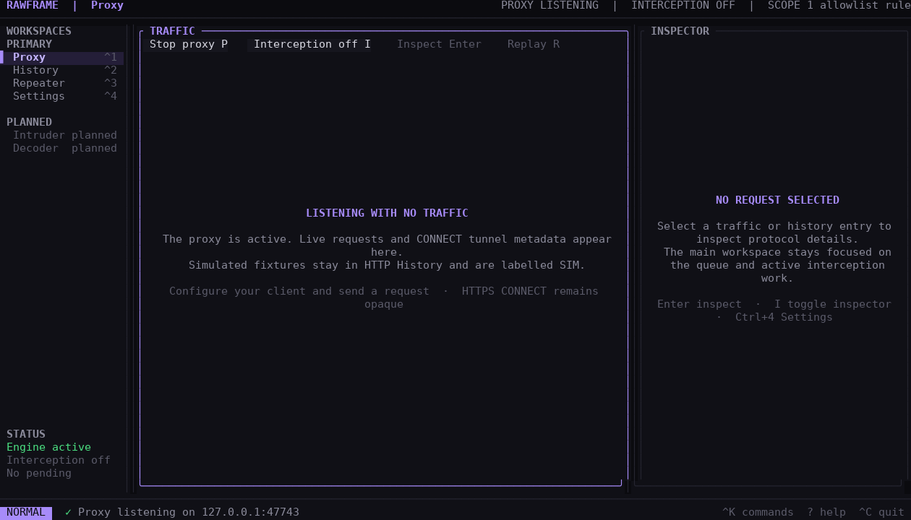 | 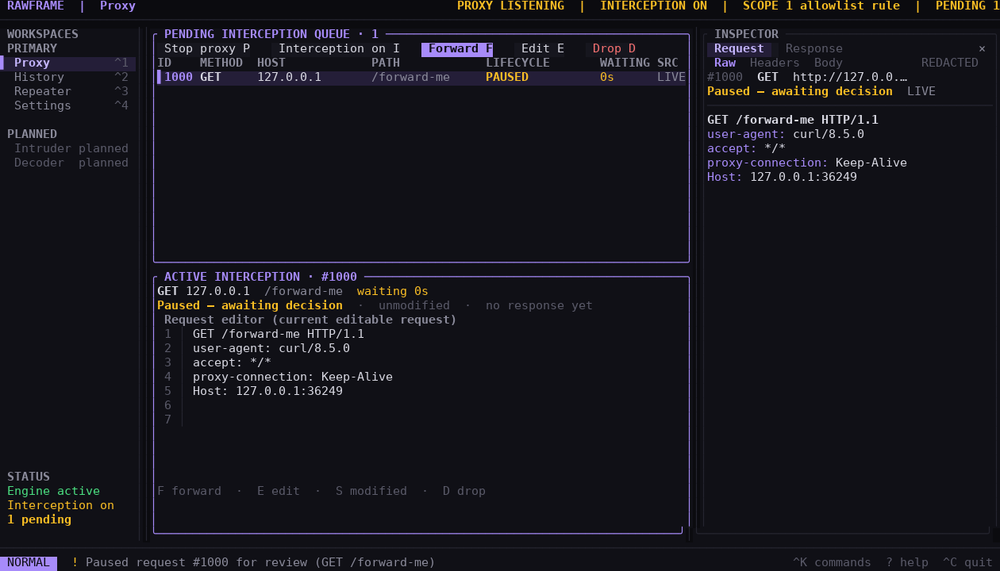 |

| Modified & forwarded (140×40) | Dropped request + inspector (140×40) |
| --- | --- |
|  | 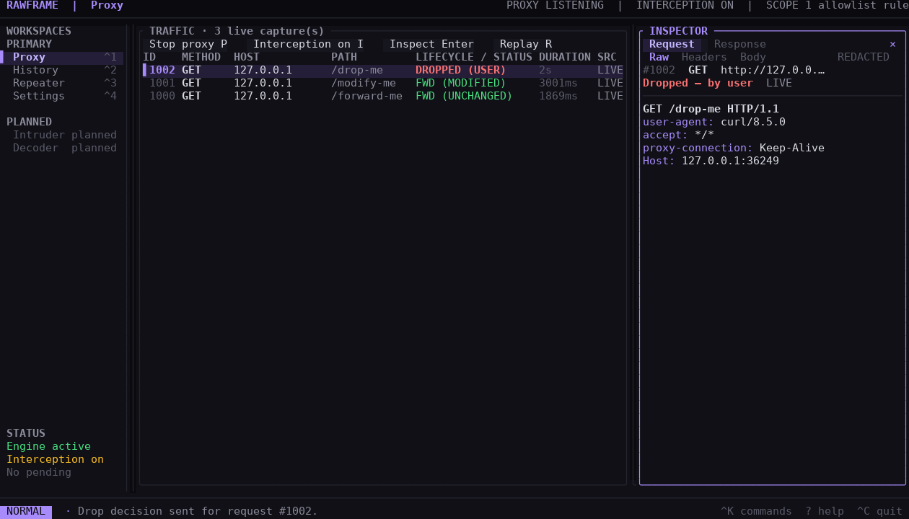 |

| Scope/policy blocked + inspector (140×40) | Narrow layout (100×30 / 80×24) |
| --- | --- |
| 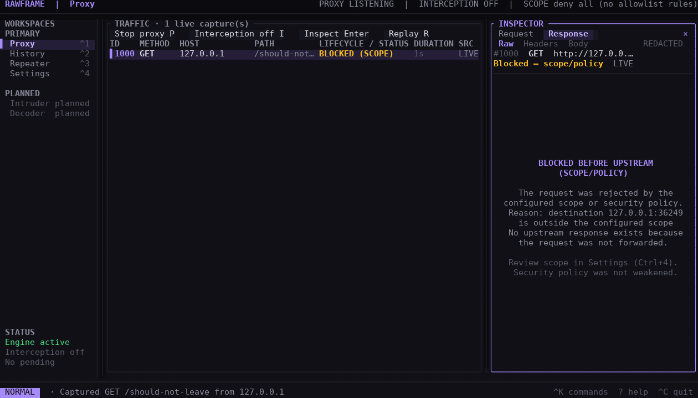 | 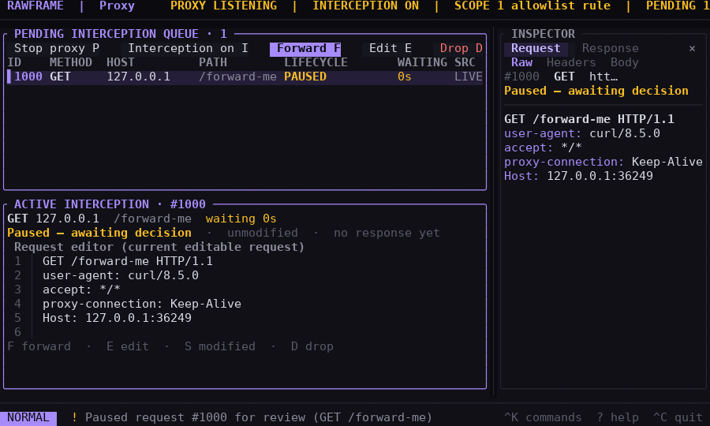 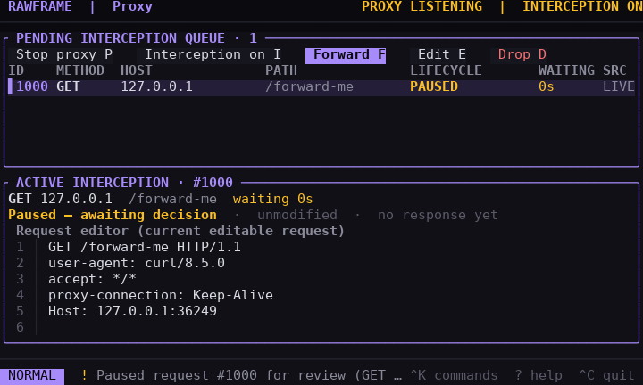 |

HTTPS interception evidence from the real-binary PTY harness (`scripts/tui_tls_pty.py`):

| TLS off: CONNECT opaque (140×40) | TLS on: decrypted HTTPS (140×40) |
| --- | --- |
| 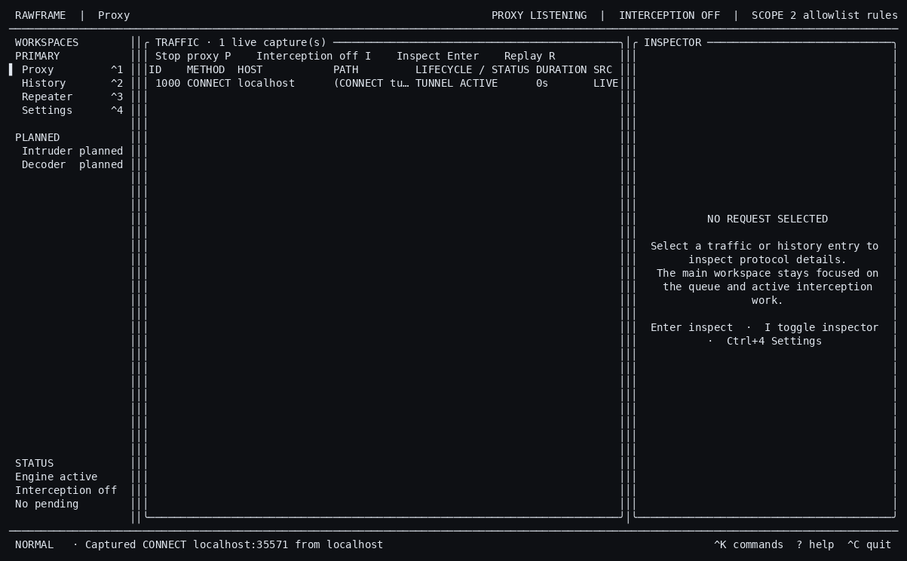 | 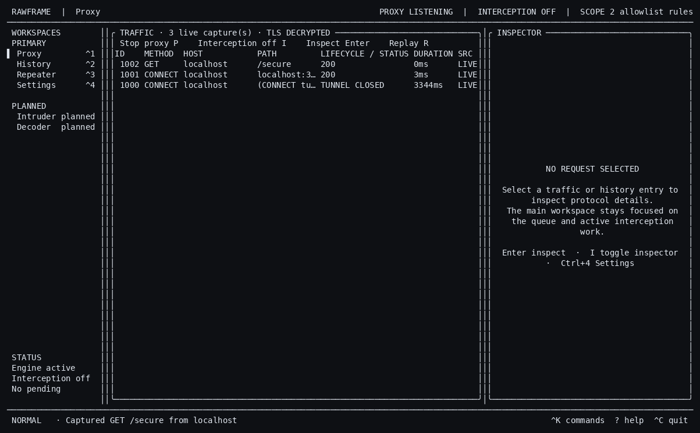 |

| CA path/fingerprint in Settings (140×40) | Upstream verification failure (140×40) |
| --- | --- |
|  | 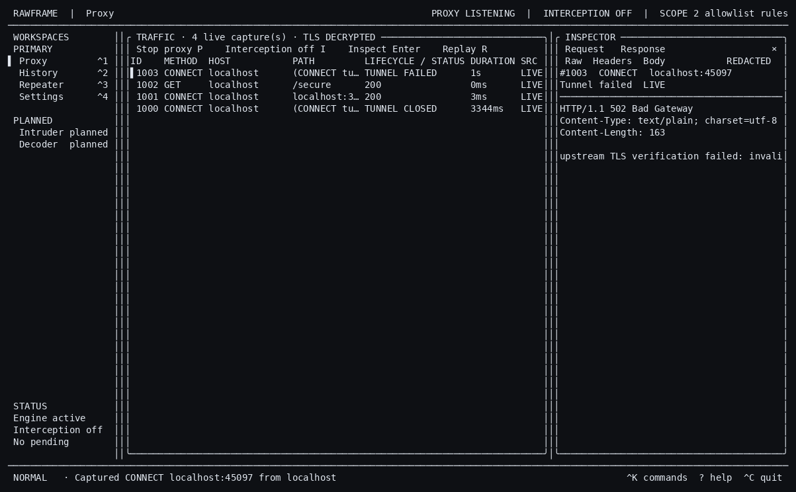 |

| Invalid CA refused (80×24) | New CONNECT opaque after disable (140×40) |
| --- | --- |
| 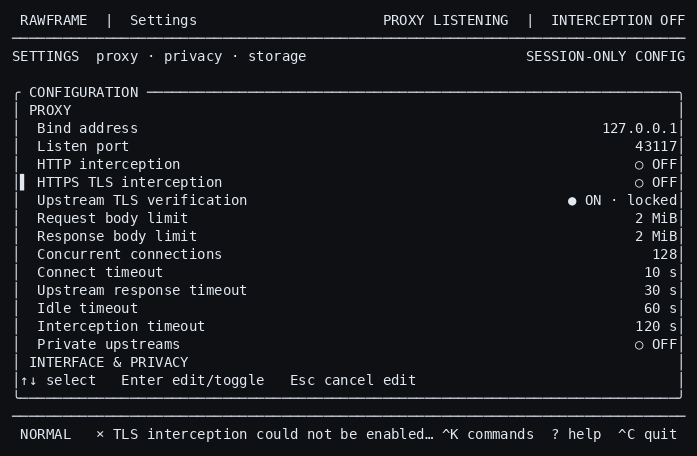 | 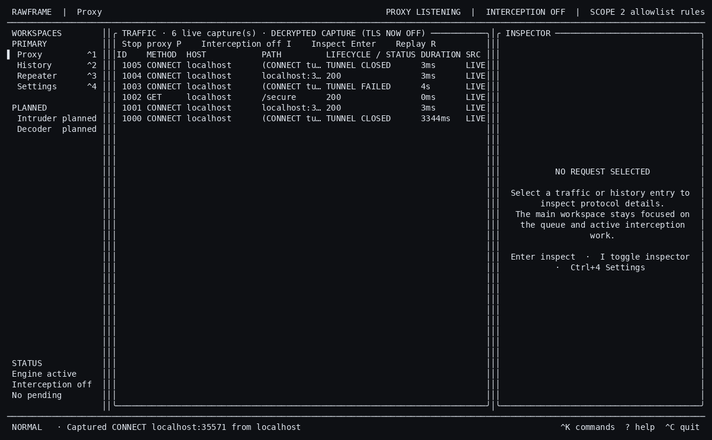 |

## What works today

| Area | Status |
| --- | --- |
| Cargo workspace, shared models, bounded event bus, command boundary | Implemented |
| HTTP/1.1 forward proxy with streaming request/response bodies | Implemented |
| IPv4/IPv6/hostname destinations; absolute-form and `Host` validation | Implemented |
| End-to-end header preservation (including duplicates, `Set-Cookie`); hop-by-hop filtering | Implemented |
| Opaque HTTPS `CONNECT` tunnelling with bidirectional half-close | Implemented |
| Default-deny scope (host/wildcard/scheme/port), DNS resolve-once address policy | Implemented |
| Request/response size, connection, connect, response, and idle limits | Implemented |
| Live HTTP capture, CONNECT metadata, failures/counts, start/stop with real lifecycle state | Implemented |
| HTTP interception: pause, inspect/edit raw request, forward unchanged/modified, drop (validated) | Implemented (engine + TUI workbench integration) |
| TUI: Proxy, HTTP History, Repeater workspace, Settings; inspector, keyboard/mouse, palette, contextual actions | Implemented |
| Live vs simulated traffic separation (labelled fixtures) | Implemented |
| Lifecycle-aware states (paused/forwarded/modified/dropped/blocked/failed/timed out/cancelled) | Implemented |
| Sensitive-header redaction and terminal-escape/bidi sanitization | Implemented |
| Opt-in HTTPS TLS interception (HTTP/1.1), local CA, per-host leaf certs, verified upstream TLS | Implemented |
| SQLite persistence, sessions, export | **Not implemented** |
| Repeater transmission | **Not implemented** |
| Intruder, Decoder | **Planned placeholders** |

Simulated fixtures use the reserved `.test` domain and never leave the machine. Live captures carry `LIVE` source badges and are distinguished from fixtures in the UI.

## Requirements

- Rust **1.88+** (edition 2024)
- Terminal **≥ 64×18** (108+ columns recommended for the inspector)
- Truecolor terminal and a monospace font with box-drawing coverage recommended (e.g. JetBrains Mono)
- Linux, macOS, and Windows terminals supported by Crossterm (mouse/truecolor depend on terminal)

## Build and quality gates

```bash
cargo fmt --all --check
cargo clippy --workspace --all-targets -- -D warnings
cargo test --workspace
# or
./scripts/check.sh
```

## Run

```bash
cargo run -p rawframe-cli --bin rawframe
```

The proxy starts **offline** with **default-deny** scope. Start it from the Proxy screen (`P` / Start).

### Quick local example (authorized local target)

```bash
# Terminal 1: local upstream
python3 -m http.server 8000 --bind 127.0.0.1

# Terminal 2: RAWFRAME (authorize only this upstream)
cargo run -p rawframe-cli --bin rawframe -- \
  --port 8080 \
  --scope http://127.0.0.1:8000 \
  --allow-private-upstreams
# Press P on the Proxy screen.

# Terminal 3: proxied request
curl --noproxy '' -x http://127.0.0.1:8080 http://127.0.0.1:8000/
```

Opaque `CONNECT` (no TLS termination; no payload/header inspection inside the tunnel):

```bash
curl --noproxy '' -x http://127.0.0.1:8080 https://example.test/
```

### Useful CLI options

```bash
rawframe --help
rawframe --port 8081
rawframe --scope example.test
rawframe --scope '*.example.test:443'
rawframe --scope https://api.example.test:443
rawframe --allow-private-upstreams
rawframe --tls-intercept --scope https://localhost:8443 --allow-private-upstreams
rawframe --tls-ca-show
rawframe --tls-ca-fingerprint
rawframe --tls-ca-export ./rawframe-ca.crt.pem
rawframe --tls-ca-regenerate      # invalidates prior client trust
rawframe --tls-upstream-ca ./upstream-ca.pem   # lab trust bundle; verification stays on
rawframe --bind 0.0.0.0 --allow-remote-bind
rawframe --no-mouse
rawframe --no-redact          # DANGEROUS: reveal sensitive header values
```

- `--scope` may be repeated. With no scope rules, requests/CONNECT are denied.
- `--allow-private-upstreams` is required for loopback/private lab targets.
- `--tls-intercept` explicitly enables HTTPS interception. It is off by default; `CONNECT` stays opaque otherwise.
- `--tls-ca-dir` selects the local CA directory. `--tls-ca-show` prints the public certificate path/fingerprint, `--tls-ca-export` exports only the public certificate, and `--tls-ca-regenerate` explicitly replaces the CA (all prior trust becomes invalid).
- `--tls-upstream-ca` replaces the platform trust store with an explicit PEM bundle for local-lab upstreams. Certificate-chain and hostname verification remain mandatory; there is no insecure mode.
- Remote listener binding requires `--allow-remote-bind` (TUI settings permit loopback only).

Default log: `$XDG_DATA_HOME/rawframe/logs/rawframe.log` or `~/.local/share/rawframe/logs/rawframe.log` (local-only, no captured headers/bodies; owner-only on Unix). Override with `--log-file`.

## Interception workflow (current)

1. Start RAWFRAME with an authorized scope (and `--allow-private-upstreams` for local/private targets as needed).
2. Start the proxy (`P`) and wait for `LISTENING`.
3. Enable interception (`I`) for matching HTTP requests through the same queue used for decrypted HTTPS.
4. Send traffic through the proxy (e.g. `curl --noproxy '' -x http://127.0.0.1:8080 http://127.0.0.1:8000/`).
5. For a paused request: `E` edit, `F` forward unchanged, `S`/`Ctrl+Enter` send modified (validated), `D` drop. Validation failures keep the request pending.
6. Resolved live transactions appear in HTTP History/inspector with lifecycle/outcome metadata. Dropped/cancelled/timed-out requests do not fabricate upstream responses; scope/policy rejections are reported as blocked (not dropped).

### HTTPS interception (opt-in)

1. Enable `HTTPS TLS interception` in Settings, or start with `--tls-intercept`. The proxy initializes or loads the local CA when interception is enabled.
2. Export the **public** CA certificate with `--tls-ca-export PATH` (or read the path shown in Settings) and explicitly trust it in the client/browser you are testing. RAWFRAME never installs trust automatically and never exports the private key.
3. Authorize the target with `--scope` (and `--allow-private-upstreams` for local lab servers), then send HTTPS through the proxy with `CONNECT`.
4. Decrypted HTTP/1.1 requests enter the existing interception queue. Pause/modify/drop/forward behavior and validation (including destination/scope revalidation) are the same as HTTP.
5. Disable `HTTPS TLS interception` in Settings (or restart without `--tls-intercept`) to return `CONNECT` to opaque tunnelling. Remove the RAWFRAME CA from any trust store when finished.
6. `--tls-ca-regenerate` replaces the CA explicitly; every client that trusted the old CA must be updated. Existing CA material is never silently replaced, and certificate/key mismatches are rejected.

Limits: TLS interception currently handles HTTP/1.1 only and does not bypass certificate pinning. Applications that pin certificates will fail as designed. Upstream TLS always verifies the certificate chain and hostname against the platform trust store (or an explicitly configured trust bundle); there is no insecure-verification switch.

## Defaults and limits

| Setting | Default | Notes |
| --- | --- | --- |
| Listener | `127.0.0.1:8080` | loopback unless explicitly authorized |
| Scope | empty allowlist (deny by default) | checked before DNS/connect |
| Max request/response body | 2 MiB each | declared/streamed bytes bounded |
| Max concurrent connections | 128 | excess connections closed |
| DNS/connect/handshake timeout | 10 s | bounded upstream establishment |
| Response-header timeout | 30 s | timeout recorded as failure |
| Body/tunnel idle timeout | 60 s | stalled streams/tunnels terminated |
| Upstream TLS verification | on (locked) | chain + hostname verified for intercepted upstream TLS |
| HTTPS TLS interception | off | explicit opt-in; opaque `CONNECT` default |
| Intercepted protocol | HTTP/1.1 | ALPN advertises only HTTP/1.1 |
| Redaction | on | sensitive headers redacted by default in inspector |

Settings are session-only. Network limit changes in the TUI apply on proxy restart.

## Keyboard and mouse

- `Ctrl+K` command palette, `Ctrl+1`…`Ctrl+4` modules, `Tab`/`Shift+Tab` focus, `?` help, `Q`/`Ctrl+C` quit.
- Navigation: `↑ ↓`/`j k`, `Enter`; Inspector: `[` `]` request/response, `1`/`2`/`3` raw/headers/body.
- Proxy: `P` start/stop, `I` interception, `Enter` inspect, `F` forward, `E` edit, `S` send modified, `D` drop (when applicable), `R` replay (where supported).
- History: `/` or `Ctrl+F` search, filters, `Ctrl+U` clear.
- Mouse: click/select, double-click inspect, right-click context actions, scroll, drag dividers to resize panes. Single-letter shortcuts do not fire while editing/searching.

## Architecture

```text
rawframe-cli ──> rawframe-tui ──> rawframe-http ──> rawframe-core
      │                │                                 ▲
      ├──> rawframe-proxy ────────────────────────────────┤
      └───────────────────────────────────────────────────┘
```

- **rawframe-core** — models, config, scope rules, lifecycle/filters, bounded event bus, commands, terminal-safety primitives, fixtures (no I/O).
- **rawframe-http** — HTTP/1.x document parsing for Repeater/tests (not the proxy wire implementation).
- **rawframe-proxy** — Tokio/Hyper listener, streaming forwarder, opaque CONNECT relay, scope/address enforcement, limits, capture events, graceful shutdown (no TUI dependency).
- **rawframe-tui** — Ratatui/Crossterm app, screens/state/rendering/input/terminal lifecycle; polls events and emits commands (no sockets).
- **rawframe-cli** — composition root/runtime, proxy worker wiring, terminal loop.

## Security model

- Default-deny scope; loopback listener by default. Remote bind and private upstreams require explicit opt-in.
- Scope checked before upstream resolution/connection; resolve-once address policy with public-address validation (private/loopback answers require opt-in; reserved/link-local/metadata/multicast/etc. rejected).
- Request/response bodies streamed with hard caps; bounded queues/connections and idle limits; failures recorded (not fabricated).
- Hop-by-hop headers stripped; end-to-end/duplicate headers preserved appropriately. Absolute-form/Host validation enforced.
- Sensitive headers redacted by default in the inspector; captured text sanitized for terminal display.
- Opaque `CONNECT` by default. With interception enabled, scope/address policy is enforced before leaf issuance, upstream resolution, upstream connection, forwarding, and modified-destination forwarding.
- Client-facing TLS uses a RAWFRAME leaf certificate; upstream TLS is a separate session with mandatory chain and hostname verification using trusted roots. There is no insecure-verification or HTTPS-to-HTTP downgrade path.
- The CA private key stays in the local CA directory with restrictive Unix permissions (`0600` key, `0700` directory), is never exported, and is never placed in events, logs, or history. Only the public certificate is exportable.
- No telemetry, no shell execution from captured content, no automatic trust-store installation. Logs are local-only.

See [docs/security.md](docs/security.md) for the threat model, controls, and known gaps.

## Current limitations & roadmap

- **Limitations:** HTTPS interception supports HTTP/1.1 only, not HTTP/2/HTTP/3, WebSocket, or certificate-pinned clients; no SQLite persistence/sessions/export; Intruder/Decoder are planned placeholders; Repeater transmission not available. The real-binary PTY regression requires Python 3 with `cryptography`; when unavailable it is skipped, but the proxy-level HTTP/HTTPS integration tests still run.
- **Roadmap:** see [docs/roadmap.md](docs/roadmap.md). Do not treat planned items as implemented.

## Documentation

- [Architecture](docs/architecture.md) · [Dependency graph](docs/dependency-graph.md) · [Security](docs/security.md) · [Development](docs/development.md) · [Roadmap](docs/roadmap.md)
- [Contributing](CONTRIBUTING.md) · [Security policy](SECURITY.md) · [License (MIT)](LICENSE)
