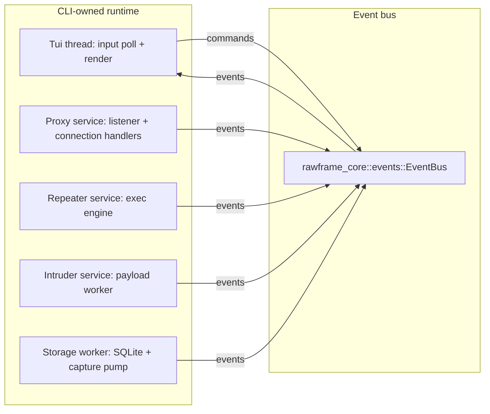

## Application startup

## CLI as composition root

`rawframe-cli` is the only composition root. `main.rs` performs the following:

1. **Parse CLI arguments** — `--port`, `--scope`, `--tls-intercept`, `--db`,
   `--no-persist`, `--project`, `--session-name`, and others.
2. **Initialize logging** — structured `tracing` subscriber with configurable
   level and format.
3. **Create Tokio runtime** — single-threaded for the TUI loop, multi-threaded
   for the proxy, Repeater, Intruder, and storage workers.
4. **Configure scope** — parse `--scope` rules and build the live allowlist.
5. **Initialize components** — spawn the proxy worker, Repeater service,
   Intruder service, storage worker, and capture pump.
6. **Subscribe to the event bus** — the TUI and CLI independently subscribe.
7. **Run the TUI** — synchronous event poll loop; no proxy or storage task is
   awaited on the UI thread.
8. **Graceful shutdown** — on `Ctrl+C` or `Q`, signal shutdown, wait for
   running tasks (up to 5–8 s), then abort remaining tasks.

## Runtime topology

The TUI polls the bounded event bus without blocking. The proxy, Repeater,
Intruder, and storage workers run on the CLI-owned runtime and meet the UI only
at channels.

## Component start-up order

1. Parse CLI args and initialize tracing.
2. Build scope allowlist from `--scope` rules.
3. Initialize the EventBus.
4. Spawn the storage worker (SQLite connection, event subscriber).
5. Spawn the capture pump (subscribes to `TrafficCaptured`/`TrafficUpdated`).
6. Spawn the proxy service (`run_service`).
7. Spawn the Repeater service.
8. Spawn the Intruder service.
9. Run the synchronous TUI event poll loop.

## Shutdown sequence

1. Signal shutdown on all services via watch channel.
2. TUI exits (confirmation dialog if unsaved edits or paused requests).
3. Wait for proxy/Repeater/Intruder to finish (up to 5 s), then abort.
4. Storage worker closes the database with `WAL checkpoint`.
5. Database file permissions restored to `0600`; directory to `0700`.

