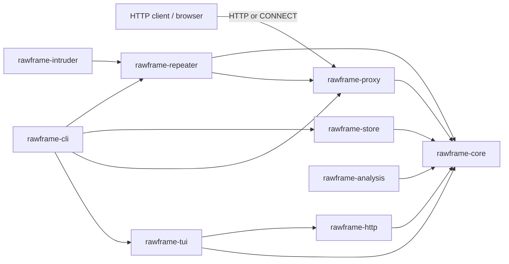

## Dependency direction

RAWFRAME enforces a strict one-way dependency flow. The TUI never opens sockets
or SQLite, and the proxy never depends on the TUI.

## Crate dependency rules

| Crate | May depend on | Must not depend on |
| --- | --- | --- |
| `rawframe-core` | Nothing (no RAWFRAME crate) | Terminal, socket, or database APIs |
| `rawframe-http` | `rawframe-core` | — |
| `rawframe-proxy` | `rawframe-core`; public `rawframe-proxy` destination/TLS helpers | `rawframe-tui`, `rawframe-repeater`, proxy listener, CA manager, interception queue |
| `rawframe-repeater` | `rawframe-core`; public `rawframe-proxy` destination/TLS functions | proxy listener, CA manager, interception queue, TUI |
| `rawframe-intruder` | `rawframe-core`; `rawframe_repeater::RepeaterEngine::execute` | own HTTP stack, TUI, storage |
| `rawframe-analysis` | `rawframe-core` only | network, terminal, or storage dependency |
| `rawframe-store` | `rawframe-core`; SQLite | proxy or TUI |
| `rawframe-tui` | `rawframe-core`; `rawframe-http` | `rawframe-proxy` |
| `rawframe-cli` | All crates | — |

## Runtime data flow

`rawframe-cli` owns a multi-thread Tokio runtime. It spawns
`rawframe_proxy::run_service`, the storage worker, and a capture pump subscribed
to the same event bus. The TUI exchanges commands and events through bounded
channels, polls without blocking, and renders captured traffic and lifecycle state.
The engines have independent command sockets but share the scope model and event
bus. The UI runtime is independent: input arrives on a Crossterm reader thread,
events are polled, and frames redraw on input or at a 250 ms idle cadence.

No proxy, Repeater, or storage task is awaited on the UI thread.

## Commands and events

Commands flow from the UI (or CLI) to the engines through bounded channels:

- `StartProxy(Box<AppConfig>)` and `StopProxy` control the engine.
- `SetInterception` arms or disarms live pause-before-upstream.
- `SetTlsInterception` explicitly enables/disables HTTPS TLS interception.
- `ForwardRequest`, `ForwardModified`, and `DropRequest` resolve pending
  interception entries.
- `UpdateScope(Scope)` replaces the live allowlist immediately for new work.
- `RepeaterCommand::{Execute, Cancel, UpdateScope, Shutdown}` are a separate
  bounded channel.
- `AppCommand::ResolveWebSocketFrame { frame, decision }` resolves a paused
  WebSocket frame.

Events fan out from the engines to the UI and storage through the EventBus:

- `ProxyStateChanged` drives `Idle → Starting → Listening → Stopping → Stopped`.
- `TrafficCaptured` / `TrafficUpdated` carry HTTP captures and lifecycle state.
- `AppEvent::Repeater(Phase|Completed)` drives the Repeater tab.
- `AppEvent::Intruder(IntruderEvent)` drives the Intruder workspace.
- `WebSocketConnection` / `WebSocketFrame` drive the WebSocket workspace.
- `TlsStateChanged` publishes TLS enabled/disabled state, CA path, and fingerprint.
- `Storage(StorageEvent)` carries persistence status and stored-session lists.
- `Notice` surfaces lifecycle warnings/errors.

Live traffic is inserted into `App::traffic` by `TrafficCaptured` /
`TrafficUpdated`. Existing pending fixtures are retained but hidden from the
Proxy queue while live captures exist.

