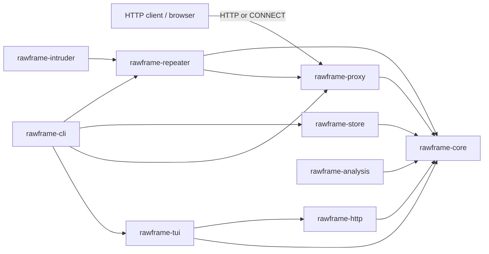

## Workspace overview

RAWFRAME is a nine-crate Cargo workspace. Dependency flow is one-way: the TUI
never opens sockets or SQLite, and the proxy never depends on the TUI.

## Crate responsibilities

| Crate | Responsibility |
| --- | --- |
| `rawframe-core` | Domain models, configuration, scope rules, lifecycle, filters, bounded event/command contracts, terminal-safety primitives, and labelled fixtures. No network or terminal I/O. |
| `rawframe-http` | Authored HTTP/1.x document parser used by Repeater and tests. Not the live proxy wire implementation. |
| `rawframe-proxy` | Tokio/Hyper listener, HTTP forwarding, opaque `CONNECT` relay, TLS interception, HTTP/1.1 WebSocket handshake and frame relay, destination policy, body guards, limits, and graceful shutdown. |
| `rawframe-repeater` | Repeater execution engine: independent HTTP/1.1 and HTTP/2 connections over verified HTTPS, redirects, bounded response capture, timeouts, cancellation, and the command service; also authored WebSocket client sessions. |
| `rawframe-intruder` | Intruder execution service: plan construction, payload expansion, bounded worker pool, rate gate, pause/resume/cancel, typed outcomes, and wordlist import. Executes through the Repeater engine. |
| `rawframe-analysis` | Passive analysis library: deterministic rules over captured HTTP and WebSocket snapshots, finding construction, fingerprinting, bounded scheduler, and report formatting. No network, terminal, or storage dependency. Not yet wired into the application. |
| `rawframe-store` | SQLite schema/migrations, a single writer thread, redaction-on-write, session queries, restore, and redacted export. No proxy or TUI dependency. |
| `rawframe-tui` | Ratatui/Crossterm application, workspaces, inspector, editor, layouts, input handling, and terminal lifecycle. |
| `rawframe-cli` | Composition root: CLI validation, logging, Tokio runtime, proxy worker, Repeater services, storage worker/capture pump, and TUI loop. |

## Dependency direction



### Rules

- `rawframe-core` depends on no RAWFRAME crate. It remains free of terminal,
  socket, and database APIs.
- `rawframe-http` depends only on `rawframe-core`.
- `rawframe-proxy` depends on `rawframe-core`; it must not depend on
  `rawframe-tui` or `rawframe-repeater`.
- `rawframe-repeater` depends on `rawframe-core` and reuses public
  `rawframe-proxy` destination/TLS-policy functions. It must not depend on the
  proxy listener, CA manager, interception queue, or TUI.
- `rawframe-intruder` depends on `rawframe-core` and calls
  `rawframe_repeater::RepeaterEngine::execute` for every generated request. It
  must not open its own HTTP stack, depend on the TUI, or touch storage.
- `rawframe-tui` depends on `rawframe-core` and `rawframe-http`; it must not
  depend on `rawframe-proxy`. It sees the proxy and Repeater only through shared
  events and bounded command senders defined in core.
- `rawframe-store` depends on `rawframe-core` and SQLite; it must not depend on
  the proxy or the TUI. The TUI never links SQLite.
- `rawframe-cli` is the only composition root and may depend on all crates. It
  hosts the capture pump that bridges the event bus to the storage worker.
```

