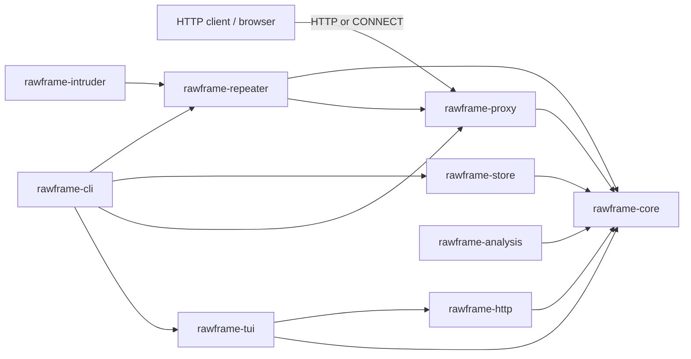

## Workspace setup

## Crate map

RAWFRAME is a nine-crate Cargo workspace. See the [Architecture] section for the
full dependency graph and crate responsibilities.

| Crate | Purpose |
| --- | --- |
| `rawframe-core` | Domain models, configuration, scope rules, lifecycle. No I/O. |
| `rawframe-http` | Authored HTTP/1.x document parser. |
| `rawframe-proxy` | Tokio/Hyper listener, HTTP forwarding, CONNECT, TLS interception. |
| `rawframe-repeater` | Repeater execution engine, WebSocket client. |
| `rawframe-intruder` | Intruder execution, payload expansion. |
| `rawframe-analysis` | Passive analysis library. |
| `rawframe-store` | SQLite persistence, schema migrations. |
| `rawframe-tui` | Ratatui/Crossterm application, workspaces, inspector. |
| `rawframe-cli` | Composition root, CLI validation, runtime. |

## Dependency flow



## Test commands

```bash
## Format check
cargo fmt --all --check

## Workspace check
cargo check --workspace

## Debug build
cargo build --workspace

## Release build
cargo build --workspace --release

## All tests
cargo test --workspace

## Clippy (warnings are errors)
cargo clippy --workspace --all-targets -D warnings

## Short form (all gates)
./scripts/check.sh
```

