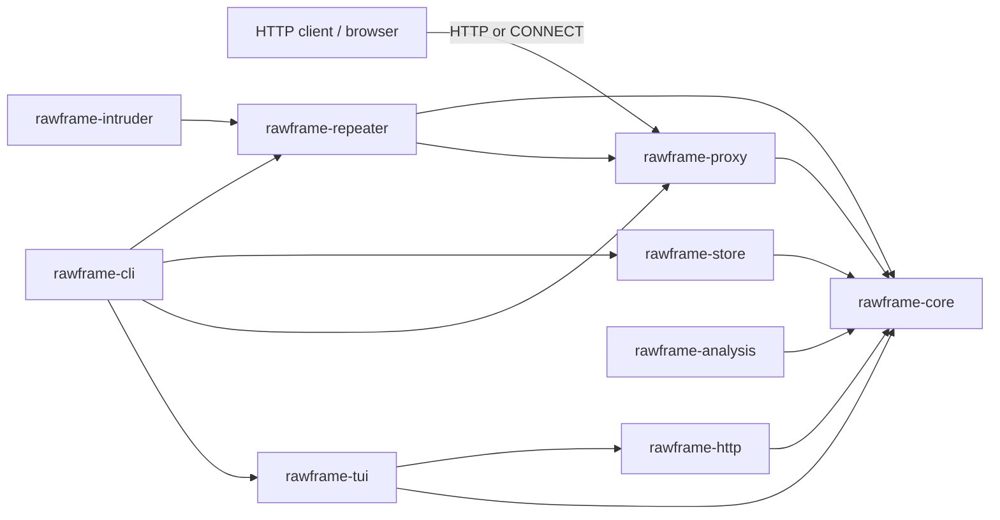

## Product overview

## Main interface

RAWFRAME’s TUI is organized into workspaces you switch between with
`Ctrl+1`–`Ctrl+7`:

| Shortcut | Workspace |
| --- | --- |
| `Ctrl+1` | Proxy |
| `Ctrl+2` | HTTP History |
| `Ctrl+3` | Repeater |
| `Ctrl+4` | Settings |
| `Ctrl+5` | Intruder |
| `Ctrl+6` | Decoder |
| `Ctrl+7` | WebSocket |

Each workspace shows live engine state, TLS status, queue state, and source
provenance. The header badge indicates `LIVE ENGINE` vs `SIMULATED`.

## Core workflows

### Proxy

- Start/stop the local forward proxy.
- Enable/disable interception to pause requests before upstream contact.
- Scope the allowlist with exact hosts, leading wildcards, scheme, and port.
- Opaque `CONNECT` tunnelling for HTTPS destinations.
- Opt-in TLS interception with per-host leaf certificates.

### History and Inspector

- Browse captured traffic with filters and sort.
- Open the request/response inspector with raw, headers, and body views.
- Redacted sensitive headers and truncated bodies by policy.
- Restore previous sessions read-only.

### Repeater

- Send requests to scoped destinations over verified TLS.
- Edit requests (method, headers, body).
- Toggle redirects (max 5 hops, credential stripping on cross-origin).
- Compare raw, headers, body, pretty JSON, or hex views.
- Safe redirect handling with per-hop scope revalidation.

### Intruder

- Build payload plans from `§…§` markers in request templates.
- Four strategies: Sniper, Battering Ram, Pitchfork, Cluster Bomb.
- Bounded concurrency (8 workers), rate gate (20/s), duration ceiling (1800 s).
- Pause, resume, and cancel in progress.

### Decoder

- 22 binary-safe transformations: Base64, hex, URL percent-decoding,
  HTML entities, Unicode escapes, JSON pretty/minify/validate, JWT inspection,
  gzip compress/decompress, SHA-256/384/512, MD5 (legacy).
- Chained pipelines with intermediate inspection (max 16 steps, 8 MiB).
- Explicit transfer of bodies to/from Repeater.

### WebSocket

- Frame-level relay and interception in both directions.
- Per-frame pause, forward, or drop decisions.
- Authored Repeater sessions with verified TLS and text composition.
- Scope-checked upgrade destination and address validation.

## Architecture at a glance

RAWFRAME is a nine-crate Cargo workspace with one-way dependency flow:

The TUI never opens sockets or SQLite. The proxy never depends on the TUI.
All nine crates are documented in the [Architecture and internals] section.

